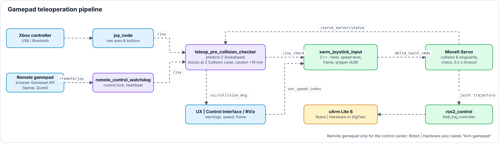

<a name="top"></a>

# 🎮 Betriebsmodi & Gamepad-Teleoperation

[🏠 Übersicht](../readme-de.html) · [🇬🇧 English](../en/teleoperation.html) · Kapitel 3.1–3.3, 5

**Inhalt:** [3.1 Betriebsmodi: Robot | Digital Twin vs. Robot | Hardware (Hardware Interfaces)](#31-betriebsmodi-fake-vs-real-hardware-interfaces) · [3.2 Funktion: Gamepad Teleoperation & Harter Kollisionsschutz](#32-funktion-gamepad-teleoperation--harter-kollisionsschutz) · [3.3 Funktion: Leap-Motion-2-Handsteuerung](#33-funktion-leap-motion-2-handsteuerung) · [5. 🎮 Gamepad-Steuerung — Technische Tiefenanalyse](#5--gamepad-steuerung--technische-tiefenanalyse)

---

## 3.1 Betriebsmodi: Robot | Digital Twin vs. Robot | Hardware (Hardware Interfaces)
Die Plattform unterscheidet strikt zwischen zwei Betriebsmodi für den Roboterarm. Diese Unterscheidung bezieht sich **ausschließlich auf das `ros2_control` Hardware Interface** und ist unabhängig von der Sensorik (wie Kamera oder YOLO, welche in beiden Modi live laufen können):

-blue?style=for-the-badge)<br>
Der Roboter läuft über das `mock_components/GenericSystem` (bzw. FakeSystem) Hardware Interface innerhalb von `ros2_control`. Es gibt keine physische Controller-Verbindung. Befehle an den `/lite6_traj_controller` oder `/servo_server` werden rein virtuell in RViz2 gerendert, indem die Joint States gespiegelt werden. Proprietäre UFactory API-Calls (wie Mode/State-Switches) laufen in diesem Modus absichtlich ins Leere oder werden softwareseitig ge-bypassed.

-red?style=for-the-badge)<br>
Das `ros2_control` Framework bindet das echte `xarm_api` Hardware Interface ein, welches via TCP/IP direkt mit dem physischen Controller des xArm Lite 6 kommuniziert. In diesem Modus greifen Hardware-Limits, physische Sicherheits-Stopps und die exklusive Umschaltung der proprietären xArm Hardware-Modi (z. B. Mode 0 für Pose-Steuerung vs. Mode 1 für Servo/Jogging) über die UFactory API.

> [!NOTE]
> **Virtuelle Linearachse (Nur Simulation):** Im Modus (Robot | Digital Twin) kann der Roboter auf einer simulierten Linearachse bewegt werden, ohne die MoveIt-Planungsgruppe (`lite6`) zu beeinflussen.
> - **Aktivierung:** Mit `attach_to:=linear_axis_link` startet der Launch (Robot | Digital Twin, `lite6_moveit_servo_fake.launch.py`) den Node `fake_linear_axis` selbst. **RUN DEV SETUP (Robot | Digital Twin)** übergibt dieses Argument; bei manuellem Start muss es an den Launch-Befehl angehängt werden.
> - **Steuerung:** Der GUI-Schieberegler im Web UI (Port 8081) oder das Gamepad-D-Pad (Links/Rechts) steuert die horizontale Verschiebung durch Publizieren auf `/linear_axis_cmd`. Der Headless-Node `fake_linear_axis` (`ros2 run fake_linear_axis fake_linear_axis`) wandelt dies in dynamisches TF und visuelle Schienen-Marker um.
> - **MoveIt-Architektur:** Die Achse wird rein über dynamisches TF (`world` -> `linear_axis_link`) verschoben und nicht als URDF-Joint in die Kinematik aufgenommen. Dadurch weiß MoveIt (dank TF) automatisch, wo der Roboter steht, ohne dass ein 7-DoF IK-Solver benötigt wird.
> - **URDF Modifikation:** Um Fehler beim Parsen von dynamischen `attach_to`-Argumenten zu vermeiden, wurde `xarm_description/urdf/xarm_device_macro.xacro` angepasst. Die Bedingung für `create_attach_link` generiert nun einen Root-Link für *jeden* übergebenen String und nicht mehr exklusiv nur für `"world"`.

<br>

### 3.1.1 📊 Simulation (Robot | Digital Twin) vs. Real-Hardware (Robot | Hardware) Matrix
Die folgende Übersicht zeigt auf einen Blick, welche Projektmodule in reiner Software-Simulation auf einem Standard-PC evaluiert werden können und welche Funktionen physische Hardware-Geräte voraussetzen:

<details>
<summary><b>🔽 Tabelle anzeigen</b> · 17 Subsysteme · Robot | Digital Twin vs. Robot | Hardware · benötigte Hardware</summary>

| Feature / Subsystem | Reine Simulation (Robot | Digital Twin) | Echte Hardware (Robot | Hardware) | Benötigte Hardware / Peripherie |
|---|:---:|:---:|---|
| **UX \| Control Interface (Port 8081)** | ✅ Funktionsfähig (RViz-Spiegelung) | ✅ Funktionsfähig (Hardware-Bewegung) | Host-PC & Webbrowser |
| **Physik-Sandbox (virtuelles Greifen)** | ✅ Funktionsfähig | ➖ Nur Simulation | Host-PC |
| **Remote Control (Client / Server)** | ✅ Funktionsfähig | ✅ Funktionsfähig (strengere Grenzen) | Laptop, Tablet oder Quest 3 im Heimnetz |
| **UX \| Compact Interface (`/touch`)** | ✅ Funktionsfähig | ✅ Funktionsfähig | Zusätzliches Touch-Display (USB + HDMI) |
| **UX \| Monitoring (Port 8083)** | ✅ Funktionsfähig | ✅ Funktionsfähig | Host-PC & Webbrowser |
| **MoveIt 2 Kartesische Pfadplanung & IK** | ✅ Funktionsfähig | ✅ Funktionsfähig | Host-PC |
| **Virtuelle Linearachse (Schiene)** | ✅ Funktionsfähig | ➖ Nur Simulation | Host-PC |
| **Gamepad-Teleoperation (MoveIt Servo)** | ✅ Funktionsfähig | ✅ Funktionsfähig | Xbox One / Series Controller |
| **Prädiktiver harter Kollisionsschutz** | ✅ Funktionsfähig | ✅ Funktionsfähig | Host-PC |
| **Akustische Sprachinteraktion (Whisper AI)** | ✅ Funktionsfähig | ✅ Funktionsfähig | Standard USB- / Laptop-Mikrofon |
| **VLA-M-Chat (Vision-Language-Action)** | 🧪 VLA-Agent plant und bewegt den Arm (Pick & Place, auch virtuelle Objekte mit der Physik-Sandbox) | 🧪 Nur Plan (Ausführung mit `allow_real_motion:=true`) | Host-PC, NVIDIA-GPU für das lokale Sprachmodell (Ollama, ~16 GB VRAM) |
| **3D YOLO Objekterkennung & Clustering** | ❌ *(oder per Rosbag-Replay)* | ✅ Funktionsfähig | Stereolabs ZED Mini (USB 3.0) |
| **Dynamische MoveIt-Kollisionsobjekte** | ❌ *(oder per Rosbag-Replay)* | ✅ Funktionsfähig | Stereolabs ZED Mini (USB 3.0) |
| **Autonome 3D-Greifroutine** | ❌ *(Benötigt 3D-Kamera)* | ✅ Funktionsfähig | xArm Lite 6 & ZED Mini |
| **Tobii-Blicksteuerung** | ❌ *(Benötigt Brille)* | ✅ Funktionsfähig | Tobii Pro Glasses 3 (WLAN / LAN) |
| **Meta Quest 3 WebXR Teleoperation** | ❌ *(Benötigt VR-Headset)* | ✅ Funktionsfähig | Meta Quest 3 (WLAN, Port 8443) |
| **Leap-Motion-2-Handsteuerung (TCP folgt Hand)** | ✅ Funktioniert (auch mit Aufnahme, `source:=replay`) | ✅ Funktioniert (Bestätigung beim Einschalten, halbes Tempo) | Ultraleap Leap Motion 2 (USB, Roboter-PC) |

</details>

---
<br>


## 3.2 Funktion: Gamepad Teleoperation & Harter Kollisionsschutz
*Dieses Subsystem steuert das manuelle Jogging des Roboters per Xbox-Controller und verhindert aktiv, dass der Roboter durch Bedienfehler mit der Arbeitsfläche kollidiert.*


---

<br>

###  `xarm_joystick_input.cpp` &nbsp;&nbsp; <sub><i>`/src/xarm_ros2/xarm_moveit_servo/src/xarm_joystick_input.cpp`</i></sub>

**Zweck & Aufgabe:** Übersetzt die bereinigten Gamepad-Signale (Analog-Sticks & Trigger) in kartesische Geschwindigkeitsbefehle (`TwistStamped`) für MoveIt Servo. Wendet exponentielles Smoothing an und steuert alle Button-Mappings.

<details>
<summary><b>🔽 Details anzeigen</b> · Run Command · Subscribes · Publishes · TF2 · Services · Action Client</summary>

> [!NOTE]
> 💻 **Run Command:**
> ```bash
> # Echte Hardware (Robot | Hardware) MoveIt Servo (mit Vakuumgreifer & 3D-Szenenobjekten):
> ros2 launch xarm_moveit_servo lite6_moveit_servo_realmove.launch.py robot_ip:=192.168.1.xxx add_vacuum_gripper:=true report_type:=dev static_objects:=true
>
> # Simulation (Robot | Digital Twin, mit virtueller Linearachse & 3D-Szenenobjekten):
> ros2 launch xarm_moveit_servo lite6_moveit_servo_fake.launch.py add_vacuum_gripper:=true attach_to:=linear_axis_link static_objects:=true
> ```
> *`rviz:=false` startet MoveIt Servo ohne RViz-Fenster (Standard `true`; in der UX | Nexus Launcher (früher „Nexus Webapp“) als Checkbox `rviz:=true` in der Servo-Action-Card).*
> *Weitere Argumente beider Launch-Files: `joystick_and_checker:=false` startet weder `joy_node` noch `teleop_pre_collision_checker` (genutzt von den Server-Sequenzen, dort hängt das Gamepad am Client-PC); `floor_collision:=false` lässt `moveit_floor_collision` weg. Beide Launches binden außerdem `standalone_move_group.launch.py` ein.*
> *(Nativ als Component im MoveIt Servo Bringup geladen)*
>
>
> **🎮 Controller-Belegung (Quick Reference):**
>> | Eingabe | Aktion | Details |
>> | :--- | :--- | :--- |
>> | **Linker Stick** (↕️/↔️) | **Verfahren (X / Y)** | *Bewegt den Roboter vor/zurück (X) und links/rechts (Y)* |
>> | **LT / RT** (Trigger) | **Heben/Senken (Z)** | *Bewegt den Roboterarm auf/ab* |
>> | **LB / RB** (Bumper) | **Rotieren (Yaw)** | *Dreht den Endeffektor um die eigene Achse* |
>> | **D-Pad** (↕️) | **Speed Control** | *Schaltet 5 Geschwindigkeitsstufen durch* |
>> | **D-Pad** (↔️) | **Linearachse** | *Bewegt den Roboter auf der Schiene (Base Y-Shift)* |
>> | **START / BACK** | **Referenzrahmen** | *Wechselt zwischen Basis- (`link_base`) und Werkzeug-Koordinaten (`link_tcp`)* |
>> | **A-Taste** (🟢) | **Greifer auf / zu bzw. Vakuum an / aus** | *Hängt vom Launch-Argument ab: `add_gripper:=true` schaltet den Lite 6 Greifer auf/zu, `add_vacuum_gripper:=true` das Vakuum an/aus. Ohne beides (`gripper_type: none`) keine Funktion.* |
>> | **B-Taste** (🔴) | **Greifer aus** | *Lite 6 Greifer: stoppt sofort und löst die Haltekraft. Vakuum: schaltet ab.* |
>> | **X-Taste** (🔵) | **Mikrofon (Voice)** | *Startet/Stoppt die Aufnahme für Whisper AI* |
>> | **Y-Taste** (🟡) | **Initialpose** | *Fährt den Roboter in die sichere Startposition* |
>
>
> 
>
>> | Topic / Interface | Msg Type | Beschreibung |
>> |---|---|---|
>> | **`/joy_check`** | `sensor_msgs/Joy` | *Liest die vom Wächter-Node bereinigten Controller-Inputs.* |
>> | **`/ui/robot_control/set_speed_index`** | `std_msgs/Int32` | *Empfängt Anpassungen der Geschwindigkeitsstufe.* |
>> | **`/ui/gripper_cmd`** | `std_msgs/String` | *Greiferbefehl der UX \| Control Interface (`open` / `close` / `off` / `toggle`) - läuft durch dieselbe Logik wie die A/B-Tasten.* |
>
>
> 
>
>> | Topic / Interface | Msg Type | Beschreibung |
>> |---|---|---|
>> | **`/servo_server/delta_twist_cmds`** | `geometry_msgs/TwistStamped` | *Sendet berechnete kartesische Geschwindigkeiten an den Servo Server.* |
>> | **`/ui/eef_position`** | `std_msgs/Float32MultiArray` | *Publiziert mit 10 Hz die Live-Pose für das Web-UI: `[x, y, z]` in mm plus Orientierungs-Quaternion `[qx, qy, qz, qw]` (`link_base` ➔ `link_tcp`).* |
>> | **`/ui/robot_control/current_speed`** | `std_msgs/Float32` | *Publiziert den aktuellen Geschwindigkeitsfaktor für das UI.* |
>> | **`/ui/joy_button_presses`** | `std_msgs/String` | *Publiziert Controller-Tastendrücke für das UI.* |
>> | **`/ui/gripper_state`** | `std_msgs/String` (latched) | *Greiferzustand (`open` / `closed` / `off`) - hält Gamepad-Toggle und UI-Buttons synchron.* |
>> | **`/ui/gripper_type`** | `std_msgs/String` (latched) | *Konfigurierter Greifer (`vacuum` / `gripper` / `none`) aus dem Launch-Argument.* |
>> | **`/ui/robot_control/current_frame`** | `std_msgs/String` | *Publiziert den aktuellen Referenzrahmen (`link_base` oder `link_tcp`).* |
>> | **`/linear_axis_cmd`** | `std_msgs/Float64` | *Publiziert Befehle zur Steuerung der Linearachse.* |
>
>
> 
>
>> | Frame / Transformation | Beschreibung |
>> |---|---|
>> | **`link_base` ➔ `link_tcp`** | *Hört auf die aktuelle TCP-Position für die Live-Telemetrie.* |
>
>
> 
>
>> | Topic / Interface | Msg Type | Beschreibung |
>> |---|---|---|
>> | **`/servo_server/start_servo`** | `std_srvs/srv/Trigger` (Client) | *Startet die MoveIt Servo-Engine beim Bringup.* |
>> | **`/servo_server/stop_servo`** | `std_srvs/srv/Trigger` (Client) | *Stoppt die MoveIt Servo-Engine sicher.* |
>> | **`/ufactory/set_vacuum_gripper`** | `xarm_msgs/srv/VacuumGripperCtrl` (Client) | *Vakuum an/aus (A-Taste, B-Taste = aus) bei `add_vacuum_gripper:=true`.* |
>> | **`/ufactory/open_lite6_gripper`** | `xarm_msgs/srv/Call` (Client) | *Öffnet den Lite 6 Greifer (A-Taste, bei `add_gripper:=true`).* |
>> | **`/ufactory/close_lite6_gripper`** | `xarm_msgs/srv/Call` (Client) | *Schließt den Lite 6 Greifer (A-Taste, bei `add_gripper:=true`).* |
>> | **`/ufactory/stop_lite6_gripper`** | `xarm_msgs/srv/Call` (Client) | *Stoppt den Lite 6 Greifer sofort und löst die Haltekraft (B-Taste, bei `add_gripper:=true`).* |
>> | **`/ufactory/get_position`** | `xarm_msgs/srv/GetFloat32List` (Client) | *Fragt die aktuelle kartesische Controller-Position beim xArm-Treiber ab.* |
>> | **`/ui/execute_initial_pose`** | `std_srvs/srv/Trigger` (Client) | *Fährt den Roboter in die definierte Home-/Initialpose (Y-Taste).* |
>
>
> 
>
>> | Topic / Interface | Msg Type | Beschreibung |
>> |---|---|---|
>> | **`/whisper/inference`** | `whisper_idl/action/Inference` | *Startet bzw. bricht die Whisper-AI-Spracherkennung per Tastendruck ab (X-Taste).* |

</details>

---

<br>

###  `teleop_pre_collision_checker.py` (`teleop_pre_collision_checker`) &nbsp;&nbsp; <sub><i>`/src/teleop_pre_collision_checker/teleop_pre_collision_checker/teleop_pre_collision_checker.py`</i></sub>

**Zweck & Aufgabe:** Sitzt als Wächter *vor* der Bewegungsübersetzung. Begrenzt das Abwärtstempo so, dass der Weg in 0,25 s nicht unter die Tischbarriere (`Z_LIMIT` = Z Collision Level, Standard 10 mm) reicht; schnellere Abwärtsbefehle werden gedrosselt (rechter Trigger zurückgenommen). Bei z ≤ `Z_LIMIT` oder wenn weniger als 10 mm/s erlaubt wären (z < `Z_LIMIT` + 2,5 mm), sperrt er abwärts ganz, meldet das auf `/ui/collision_msg` und löst das Rumble-Feedback (Vibration) des Gamepads aus.

<details>
<summary><b>🔽 Details anzeigen</b> · Run Command · Subscribes · Publishes · Parameters</summary>

> [!NOTE]
> 💻 **Run Command:**
> ```bash
> ros2 run teleop_pre_collision_checker teleop_pre_collision_checker
> ```
>
>
> 
>
>> | Topic / Interface | Msg Type | Beschreibung |
>> |---|---|---|
>> | **`/joy`** | `sensor_msgs/Joy` | *Roher Gamepad-Input von `joy_node`.* |
>> | **`/servo_server/status`** | `std_msgs/Int8` | *Überwacht Status-Codes des Servo-Servers.* |
>> | **`/ui/eef_position`** | `std_msgs/Float32MultiArray` | *Bezieht die aktuelle Z-Höhe für den prädiktiven Kollisions-Check.* |
>> | **`/ui/robot_control/current_speed`** | `std_msgs/Float32` | *Liest den aktuellen Geschwindigkeitsfaktor zur dynamischen Dämpfungsberechnung.* |
>> | **`/ui/moveit_collision_ground_enabled`** | `std_msgs/Bool` (latched) | *Folgt dem Boden-Kollisionsschalter der UX \| Control Interface: Ist er AUS, wird die Abwärtsbewegung nicht mehr gesperrt. Ohne Nachricht (Node läuft nicht) bleibt die Sperre aktiv.* |
>> | **`/ui/ground_collision_level`** | `std_msgs/Float64` (latched) | *Z Collision Level in mm (TCP-Höhe) von `moveit_floor_collision`, eingestellt im Boden-Kollisions-Popup der UX \| Control Interface → `Z_LIMIT`, Vorsichtszone beginnt 19 mm darüber. Auf 0–200 mm geklemmt. Bis zur ersten Nachricht gilt streng 91 mm (ohne diesen Node fehlt auch die Bodenbox in MoveIt Servo).* |
>> | **`/ui/emergency_stop_active`** | `std_msgs/Bool` (latched) | *E-STOP verriegelt → Gamepad gesperrt; nach dem Quittieren geht `/joy` erst nach 0,3 s Ruhelage durch (`NEUTRAL_HOLD`).* |
>> | **`/ui/emergency_stop_topic`** | `std_msgs/Empty` | *E-STOP gedrückt → sperrt sofort, auch wenn der Motion Handler hängt; frei erst nach dem Quittieren (true → false).* |
>
>
> 
>
>> | Topic / Interface | Msg Type | Beschreibung |
>> |---|---|---|
>> | **`/joy_check`** | `sensor_msgs/Joy` | *Leitet das auf Kollisionen geprüfte Gamepad-Signal an `xarm_joystick_input` weiter.* |
>> | **`/ui/collision_msg`** | `std_msgs/String` | *Meldet harte Stopps an das UI-Log.* |
>> | **`/ui/emergency_stop_topic`** | `std_msgs/Empty` | *Nur wenn `/ui/emergency_stop_active` nach einem E-STOP `false` ohne vorheriges `true` meldet (Neustart eines hängenden Motion Handlers): sendet den E-STOP neu (bis 5×, 1 Hz, `ESTOP_RESEND_TRIES`), bis der neue Motion Handler verriegelt.* |
>
> *Das haptische Rumble-Feedback des Xbox-Controllers wird nicht über ROS verschickt, sondern direkt über `pygame` am Joystick-Gerät ausgelöst (`joystick.rumble(...)`).*
>
> *Rückmeldung im Browser der UX | Control Interface (früher „Robot Control UI“) (Port 8081), nur solange dieser Client den Control-Lock hat (`hasControlLock()` in `js/remote.js`):*
> - *`js/gamepad.js`: ein am Browser angeschlossenes Gamepad rüttelt (Gamepad API `vibrationActuator.playEffect('dual-rumble')`), solange der Roboter fährt und weniger als 20 mm über der Z Collision Level, 20 mm vor der unerreichbaren Zone um die Achse, 30 mm vor der Reichweite von 440 mm (ab Schulter, Z 243,5 mm) oder in den äußeren 10 % eines Gelenkbereichs ist bzw. Servo Singularität, Gelenkgrenze oder Kollision meldet; je näher an der Grenze, desto stärker.*
> - *`js/twin/xr_feedback.js`: die Quest-3-Controller pulsieren bei Greifkontakt (Vakuum `closed` oder Objekt in der Physik-Sandbox gehalten) und wiederholt nahe denselben Grenzen.*
> - *`js/sound.js`: synthetische Töne (Web Audio API, keine Audiodateien) für Vakuum AN/AUS, Grenzwarnung und E-STOP; stumm mit dem Ton-Schalter im Header.*
>
>
> 
>
>> | Parameter | Wert | Beschreibung |
>> |---|---|---|
>> | `LOOKAHEAD_TIME` | `0.25` | *Prädiktionshorizont (Sekunden) für die Geschwindigkeits-Vorausschau.* |
>> | `Z_LIMIT` | `91.0` → Level | *Die harte Tischbarriere auf der Z-Achse (`link_base`) in Millimetern; folgt `/ui/ground_collision_level`.* |
>> | `CAUTION_ZONE_START` | `Z_LIMIT + 19` | *Z-Höhe (mm), ab der das Tempo nach unten zur Sicherheit begrenzt wird (`CAUTION_ZONE_MARGIN` 19 mm über `Z_LIMIT`).* |
>> | `CAUTION_ZONE_SPEED` | `0.25` | *Maximal erlaubter Geschwindigkeitsfaktor nach unten innerhalb der Caution Zone.* |
>> | `MAX_LINEAR_VELOCITY_MM_S` | `400.0` | *Angenommene Lineargeschwindigkeit (mm/s) als Basis der Vorausschau.* |
>> | `MIN_DOWN_SPEED_MM_S` | `10.0` | *Mindesttempo abwärts (mm/s); erlaubt die Vorausschau weniger, wird abwärts ganz gesperrt (Kollisionsmeldung).* |
>> | `ACCELERATION_FACTOR` | `0.9` | *Dämpfungsfaktor für die vorausberechnete Geschwindigkeit.* |
>> | `DOWN_TRIGGER_AXIS` | `5` | *Joy-Achsen-Index des rechten Triggers (RT, abwärts).* |
>> | `UP_TRIGGER_AXIS` | `2` | *Joy-Achsen-Index des linken Triggers (LT, aufwärts); Z-Tempo = LT − RT, der Wächter begrenzt also den Netto-Abwärtsanteil.* |
>> | `EEF_TIMEOUT` | `1.0` | *Sekunden ohne neue `/ui/eef_position`, nach denen die Position als unbekannt gilt und abwärts gesperrt wird.* |

</details>

---

<br>

###  `laser_pointer_node.py` (`tcp_laser_pointer`) &nbsp;&nbsp; <sub><i>`/src/tcp_laser_pointer/tcp_laser_pointer/laser_pointer_node.py`</i></sub>

**Zweck & Aufgabe:** Überwacht kontinuierlich via TF2 mit 10 Hz die reale kartesische Z-Höhe des Tool Center Points (`link_tcp`) relativ zur Roboterbasis (`link_base`). Sobald der TCP eine Höhe von $50\text{ mm}$ ($0.05\text{ m}$) oder weniger erreicht, schaltet der Node den am Greifer montierten Laserpointer über den digitalen Tool-Ausgang (TGPIO Digital Out 0) automatisch EIN. Übersteigt die Höhe die Schwelle, schaltet er den Laserpointer sofort wieder AUS.

<details>
<summary><b>🔽 Details anzeigen</b> · Run Command · TF2 · Services</summary>

> [!NOTE]
> 💻 **Run Command:**
> ```bash
> ros2 run tcp_laser_pointer laser_pointer_node
> ```
>
>
> 
>
>> | Frame / Transformation | Beschreibung |
>> |---|---|
>> | **`link_base` ➔ `link_tcp`** | *Überwacht die Live-TCP-Position bei 10 Hz.* |
>
>
> 
>
>> | Topic / Interface | Msg Type | Beschreibung |
>> |---|---|---|
>> | **`/ufactory/set_tgpio_digital`** | `xarm_msgs/srv/SetDigitalIO` (Client) | *Schaltet Tool Digital Output 0 (TGPIO) am Greifer EIN (1) bzw. AUS (0); Namespace aus Parameter `hw_ns` (Standard `ufactory`).* |

</details>

---

<br>

###  `_robot_moveit_servo_fake.launch.py` / `_robot_moveit_servo_realmove.launch.py` (`xarm_moveit_servo`) &nbsp;&nbsp; <sub><i>`/src/xarm_ros2/xarm_moveit_servo/launch`</i></sub>

**Zweck & Aufgabe:** Die Echtzeit-Bewegungs-Engine von MoveIt. Prüft jeden Befehl gegen die Planungsszene (YOLO-Kollisionsobjekte, Boden) und bremst bzw. stoppt den Arm, bevor er mit Objekten kollidiert.

<details>
<summary><b>🔽 Details anzeigen</b> · Subscribes · Publishes · Parameters</summary>

> [!NOTE]
> 
>
>> | Topic / Interface | Msg Type | Beschreibung |
>> |---|---|---|
>> | **`/servo_server/delta_twist_cmds`** | `geometry_msgs/TwistStamped` | *Liest die kartesischen Geschwindigkeitsbefehle.* |
>> | **`/planning_scene`** | `moveit_msgs/PlanningScene` | *Liest die aktuelle 3D-Kollisionsszene zur Hindernisvermeidung ein.* |
>
>
> 
>
>> | Topic / Interface | Msg Type | Beschreibung |
>> |---|---|---|
>> | **`/lite6_traj_controller/joint_trajectory`** | `trajectory_msgs/JointTrajectory` | *Sendet validierte Gelenktrajektorien an den Roboter.* |
>
>
>  **(`xarm_moveit_servo_config.yaml`)**
>
>> | Parameter | Standardwert | Beschreibung |
>> |---|---|---|
>> | `check_collisions` / `collision_check_rate` | `true` / `10.0` | *Kollisionsprüfung des ganzen Roboterkörpers mit 10 Hz.* |
>> | `self_collision_proximity_threshold` / `scene_collision_proximity_threshold` | `0.01` | *Unterhalb dieser Abstände (1 cm) bremst Servo exponentiell in alle Richtungen ab.* |
>> | `collision_check_type` | `stop_distance` | *Einstellung des Stop-Distance-Modus (Abbremsen ab ca. 5 cm, Halt bei 2 cm über `min_allowable_collision_distance: 0.02`). Laut Kommentar in der Config wertet MoveIt Servo in Humble nur den Threshold-Modus aus, praktisch entscheiden also die Proximity-Schwellen oben.* |
>> | `collision_distance_safety_factor` | `0.5` | *Sicherheitsfaktor des Stop-Distance-Modus.* |

</details>

---


## 3.3 Funktion: Leap-Motion-2-Handsteuerung
*Eine Leap Motion 2 am Roboter-PC erkennt eine Hand von unten: Daumen und Zeigefinger zusammenführen (kneifen) kuppelt die Hand an den TCP, der TCP folgt der Hand, Hand öffnen hält an. Bedienung im Viewport der UX | Control Interface; nur Verschieben, keine Drehung.*

---

<br>

###  `leap_hand_teleop_node.py` (`leap_hand_teleop`) &nbsp;&nbsp; <sub><i>`/src/leap_hand_teleop/leap_hand_teleop/leap_hand_teleop_node.py`</i></sub>

**Zweck & Aufgabe:** Macht aus der kneifenden Hand eine kartesische Geschwindigkeit: TCP-Soll = TCP-Position beim Kuppeln + Handweg / Skala (1:1, 1:2, 1:4), nachgeführt von einem P-Regler (Totband 1,5 mm, höchstens 300 mm je Achse und Griff). Kein eigener Bewegungsweg: wie der VR-Node sendet er `/remote/twist` an das Twist-Gate von `remote_control_watchdog` (Control-Lock, Heartbeat, E-STOP, Bodenbremse) → MoveIt Servo. Die Handdaten liefert `leap.py` aus `__Project_Claude_Ops` (per Pfad geladen). Quelle der Wahrheit: README des Pakets; Ultraleap-Software einrichten: `__Project_Claude_Ops/README.md`, Abschnitt *Gestensteuerung (Leap Motion 2 oder Webcam)* › *Leap Motion 2 einrichten*.

```text
Leap Motion 2 ──▶ leap_hand_teleop_node ──▶ /remote/twist ──▶ remote_control_watchdog ──▶ /servo_server/delta_twist_cmds ──▶ MoveIt Servo
```

**Bedienung (UX | Control Interface, Viewport):**

| Schritt | Aktion | Ergebnis |
|---|---|---|
| Einschalten | ✋ **Gestures** (deutsch *Gesten*) in der Viewport-Leiste | Mit angesteckter Leap Motion 2 und laufendem Node wählt Gestures die Leap statt der Webcam; das Fenster **LEAP** öffnet sich unten rechts im Viewport. Robot \| Hardware (auch Modus unbekannt): Dialog *Leap-Handsteuerung für den echten Roboter einschalten?* – **Halten zum Einschalten** 1 s halten |
| Hand zeigen | Eine Hand etwa 20 cm über die Leap Motion halten | Chip **Bereit**; der Ring zeigt die Hand von oben, der Bogen = Kneif-Stärke |
| Kuppeln | Daumen und Zeigefinger zusammenführen | Chip **Gekuppelt**; der TCP folgt der Hand – Mitte des Rings = TCP, Punkt = TCP-Ziel |
| Anhalten | Hand öffnen | Null-Twist, entkuppelt; weiter: erneut kneifen |
| Skala | Knopf **1:2** im LEAP-Fenster | Wechselt 1:1 / 1:2 / 1:4 (1:2 = TCP fährt den halben Handweg), wirkt sofort, bleibt je Browser gespeichert |
| Ausschalten | **Gestures** erneut | Fenster schließt; Wechsel Robot \| Digital Twin ↔ Robot \| Hardware oder 2 s ohne Daten vom Leap-Node schalten ebenfalls aus. Verdeckter Tab: in Robot \| Hardware (auch Modus unbekannt) aus – erneutes Einschalten fragt wieder mit dem 1-s-Halte-Dialog; im Robot \| Digital Twin nur Pause (Node hält an, entkuppelt), zurück im Tab kuppeln mit neuem Kneifen |

- **Tempo:** Tempo-Override im Header (5 Stufen = Faktor 0,1–0,5 auf `/ui/robot_control/current_speed`, × 400 mm/s → 40 / 80 / 100 / 100 / 100 mm/s), ohne Stufe 40 mm/s, nie über `max_speed_mm_s` (100 mm/s). Außer im Robot | Digital Twin (auch Modus unbekannt) zusätzlich × `real_max_speed` des Watchdogs (Standard 0,5) – halbes Tempo wie bei entfernten Clients.
- **Geisterhand:** Layers-Panel › **Leap hand** (*Ghost at the TCP*; deutsch *Leap-Hand*, *Geisterhand am TCP*) zeigt die erkannte Hand am TCP im Digital Twin – nur Anzeige, nur bei eingeschalteter Leap-Handsteuerung.
- **Nur eine Hand:** Kneifen ist keine Zustimmtaste – jede kneifende Hand über der Leap bewegt den Roboter. Eine zweite Hand über der Leap hält immer an (Chip **Keine Hand**). In Robot | Hardware nur die eigene Hand über der Leap.

**Totmann und Sperren** (jedes Ereignis = Null-Twist und entkuppelt; neu kuppeln erst nach sichtbar geöffneter Hand und neuem Kneifen – ein über das Ereignis gehaltenes Kneifen fährt nie von selbst an):

| Ereignis | Anzeige (Chip **Gesperrt** oder **Keine Hand**) |
|---|---|
| Hand geöffnet, Hand weg oder ungültige Handwerte (NaN, außerhalb 0–1), 100 ms ohne Daten (`data_timeout_s`) | *Hand geöffnet – zum Kuppeln erneut zusammenführen* (nur kurz, danach Chip **Bereit**) · *Keine Hand über der Leap Motion* (auch bei ungültigen Werten) · *Keine Daten von der Leap Motion* |
| Zweite Hand über der Leap (auch wenn die gekuppelte Hand sichtbar bleibt); erneutes Kuppeln erst, wenn nur noch eine Hand da ist | *Zwei Hände über der Leap Motion – nur eine Hand darüber halten* |
| Schlechte Erkennung (`min_confidence`), Sprung > `jump_mm`, andere Hand | *Hand nicht sicher erkannt – flach und ruhig halten* · *Eine andere Hand wurde erkannt* (nur kurz) |
| UI hat Leap ausgeschaltet, Tab verdeckt, 0,75 s kein `/leap/config` (vor dem Heartbeat-Halt des Watchdogs nach 1 s) | *Leap-Steuerung ist aus* |
| Browser ohne Steuerung, `/leap/config` eines anderen Browsers mit Steuerung während gekuppelt | *Dieser Browser hat keine Steuerung (Control-Lock)* · *Ein anderer Browser hat die Leap-Steuerung eingeschaltet – hier angehalten* |
| E-STOP, geplante Fahrt läuft (`/ui/motion_busy`), mobile Basis fährt (`/mobile_base/moving`) | *E-STOP ist verriegelt* · *Eine geplante Fahrt läuft* · *Die mobile Basis fährt* |
| TCP-Pose (tf) fehlt oder älter als 0,15 s | *Keine Roboterpose (tf) – läuft der Roboter-Stack?* |
| Aufnahme (`source:=replay`) außerhalb Robot \| Digital Twin | *Aufgezeichnete Handdaten (Replay) bewegen den Roboter nur im Robot \| Digital Twin* |

Ereignisse ohne anhaltende Sperre (Hand geöffnet, andere Hand, anderer Browser) zeigen ihren Text nur kurz; danach steht der Chip auf **Bereit** – bei weiter geschlossener Hand mit *Erst Hand öffnen, dann erneut zusammenführen*. *Ungültige Werte von der Leap Motion – angehalten* erscheint nur, wenn die berechnete Geschwindigkeit nicht endlich ist (z. B. NaN aus tf).

<details>
<summary><b>🔽 Details anzeigen</b> · Run Command · Subscribes · Publishes · Parameters</summary>

> [!NOTE]
> 💻 **Run Command:**
> ```bash
> # mit der UX | Control Interface (nur Roboter-PC, nie auf Clients):
> ros2 launch http_robot_control_ui_p8081 http_robot_control_ui.launch.py leap_hand:=true
>
> # allein, Test ohne Gerät mit Aufnahme (fährt nur im Robot | Digital Twin):
> ros2 launch leap_hand_teleop leap_hand_teleop.launch.py source:=replay
> ```
>
>
> 
>
>> | Topic / Interface | Msg Type | Beschreibung |
>> |---|---|---|
>> | **`/leap/config`** | `std_msgs/String` (JSON) | *`{"id", "on", "scale"}` von der UI alle 250 ms; nur über die lokale rosbridge 9092 (Roboter-PC), für entfernte Clients in `config/network.yaml` gesperrt.* |
>> | **`/ui/robot_control/current_speed`** | `std_msgs/Float32` (latched) | *Tempo-Stufe 0–1 der UI (Anteil von 400 mm/s).* |
>> | **`/remote/control_state`** | `std_msgs/String` (JSON) | *Inhaber des Control-Locks, Modus `fake`/`real`, `limits.real_max_speed`.* |
>> | **`/ui/emergency_stop_active`**, **`/ui/motion_busy`**, **`/mobile_base/moving`** | `std_msgs/Bool` (latched) | *Sperrt das Kuppeln, solange true.* |
>> | **`/ui/emergency_stop_topic`** | `std_msgs/Empty` | *E-STOP gedrückt: verriegelt sofort; frei erst nach `/ui/emergency_stop_active` true → false.* |
>> | **tf** Basis → TCP | `tf2` | *Aktuelle TCP-Position; älter als 0,15 s = Stopp.* |
>
>
> 
>
>> | Topic / Interface | Msg Type | Beschreibung |
>> |---|---|---|
>> | **`/remote/twist`** | `std_msgs/String` (JSON) | *Kartesische Geschwindigkeit mit Client-id, 50 Hz, nur gekuppelt – dasselbe Twist-Gate wie Jogging und VR-Node.* |
>> | **`/leap/hand`** | `std_msgs/String` (JSON) | *Zustand für den Ring, 30 Hz: `state` (`nohand`/`ready`/`blocked`/`coupled`) + `reason`, `scale`, `tcp`, `target`, `delta` (mm), `hand` (21 Gelenke).* |
>
>
> 
>
>> | Parameter | Standardwert | Beschreibung |
>> |---|---|---|
>> | `source` | `leap` | *`leap` = Gerät, `replay` = Aufnahme `replay_file` (spielt einmal; endlos mit Node-Parameter `replay_loop` true – kein Launch-Argument); Gestures wählt eine Aufnahme nie.* |
>> | `mount_yaw_deg` | `0.0` | *Blickrichtung des Nutzers: 0 = hinter dem Roboter mit Blick in +X, 180 = gegenüber.* |
>> | `max_speed_mm_s` | `100.0` | *Obere Tempo-Grenze (5–250).* |
>> | `kp` / `deadband_mm` / `smooth` | `4.0` / `1.5` / `0.35` | *P-Regler, Totband, Glättung; `kp` ≤ 8.* |
>> | `max_offset_mm` / `jump_mm` | `300.0` / `60.0` | *Max. Versatz je Achse und Griff; Handsprung, der entkuppelt (≤ 100).* |
>> | `min_confidence` / `data_timeout_s` | `0.5` / `0.1` | *Erkennungsgüte ≥ 0,3; Daten-Timeout ≤ 0,2 s. Werte außerhalb der Grenzen beenden den Node beim Start.* |
>> | `record_file` | *(leer)* | *Schreibt Handbilder als JSONL mit (neue Testdaten).* |

</details>

---
<br>


## 5. 🎮 Gamepad-Steuerung — Technische Tiefenanalyse

Dieser Abschnitt liefert eine vollständige technische Referenz für die zweistufige Gamepad-Pipeline, die eine kollisionssichere Echtzeit-Teleoperation des xArm Lite 6 mit dem Xbox One Elite Series 2 Controller ermöglicht.


---

<br>


### 5.1 Pipeline-Architektur

Das Gamepad-Signal durchläuft zwei Stufen, bevor es den MoveIt Servo Server erreicht. Dieses Zwei-Node-Design trennt **Sicherheitsdurchsetzung** (Python) von **Bewegungsübersetzung** (C++):

<p align="center"></p>

*Gamepad-Teleoperations-Pipeline · Quelle: `tools/make_diagrams.py`*

---
<br>


### 5.2 `teleop_pre_collision_checker.py` — Kollisionswächter (Python Node)

**Datei:** `src/teleop_pre_collision_checker/teleop_pre_collision_checker/teleop_pre_collision_checker.py`

Dieser Node fungiert als transparenter **Sicherheits-Proxy** zwischen dem rohen Joystick-Treiber und dem Motion-Controller. Er ist **zu 100% Hardware-unabhängig** (funktioniert identisch im Modus (Robot | Hardware) und Modus (Robot | Digital Twin)). Er abonniert kontinuierlich die Live-Z-Höhe von `/ui/eef_position` und prüft bei jedem eingehenden `/joy`-Signal prädiktiv, ob sich der Roboter dem Tisch nähert. Würde ein Limit unterschritten, wird das Signal blockiert. Er liefert zudem **haptisches Feedback** (Gamepad-Vibration), wenn sich der Roboter dem Tisch nähert oder über MoveIt Servo ein dynamisches 3D-Hindernis (YOLO Bounding Box) erkannt wird.
<br>


#### 5.2.1 Prädiktiver Kollisions-Algorithmus

Der Node prüft nicht einfach die aktuelle Z-Position — er **begrenzt das Abwärtstempo** so, dass der Weg in den nächsten `LOOKAHEAD_TIME` Sekunden nicht unter `Z_LIMIT` reicht. Erst bei z ≤ `Z_LIMIT` oder wenn weniger als `MIN_DOWN_SPEED_MM_S` erlaubt wäre, sperrt er abwärts ganz:

```
trigger_intensity = clamp(axes[LT] - axes[RT], 0, 1) # wie xarm_joystick_input: halb gedrückt = volles Tempo
if ground_enabled and current_z < CAUTION_ZONE_START: # Vorsichtszone: wirklich langsamer
 trigger_intensity = min(trigger_intensity, CAUTION_ZONE_SPEED / speed_factor)
 axes[RT] = axes[LT] - trigger_intensity # zurückgenommener Trigger geht weiter
if ground_enabled and moving_down:
 allowed = (current_z − Z_LIMIT) / LOOKAHEAD_TIME # mm/s, die in Δt nicht unter Z_LIMIT führen
 effective_velocity = V_max × speed_factor × trigger_intensity × α # α = 0.9
 if current_z <= Z_LIMIT or allowed < MIN_DOWN_SPEED_MM_S:
  axes[RT] = 1.0 # abwärts gesperrt + /ui/collision_msg + Rumble
 elif effective_velocity > allowed:
  axes[RT] = axes[LT] − allowed / (V_max × speed_factor × α) # Trigger zurückgenommen
```

<details>
<summary><b>🔽 Tabelle anzeigen</b> · 10 Parameter · Z-Limit · Vorsichtszone · Lookahead</summary>

| Parameter | Wert | Beschreibung |
|---|---|---|
| `Z_LIMIT` | Z Collision Level (Standard `10.0 mm`) | *Absolutes Z-Limit (Tischbarriere)* |
| `CAUTION_ZONE_START` | `Z_LIMIT + 19 mm` | *Beginn der Vorsichtszone — rechter Trigger wird zurückgenommen, bis Tempostufe × Abwärtsanteil ≤ `CAUTION_ZONE_SPEED`* |
| `CAUTION_ZONE_SPEED` | `0.25` | *Max. Faktor abwärts in der Vorsichtszone* |
| `MAX_LINEAR_VELOCITY_MM_S` | `400.0 mm/s` | *Angenommene max. Lineargeschwindigkeit* |
| `LOOKAHEAD_TIME` | `0.25 s` | *Vorhersagehorizont* |
| `MIN_DOWN_SPEED_MM_S` | `10.0 mm/s` | *Langsamer erlaubt → abwärts ganz gesperrt (Kollisionsmeldung)* |
| `ACCELERATION_FACTOR` (α) | `0.9` | *Dämpfungsfaktor* |
| `DOWN_TRIGGER_AXIS` | `5` (RT) | *Joy-Achsen-Index für Abwärts-Trigger* |
| `UP_TRIGGER_AXIS` | `2` (LT) | *Joy-Achsen-Index für Aufwärts-Trigger (Netto-Z = LT − RT)* |
| `EEF_TIMEOUT` | `1.0 s` | *Ohne neue `/ui/eef_position` gilt die Position danach als unbekannt — abwärts gesperrt* |

</details>

---
<br>


#### 5.2.2 Zwei-Stufen-Sicherheitsmodell

```
Z > Z_LIMIT + 19 mm → Volle Geschwindigkeit, keine Einschränkungen
Z_LIMIT + 19 mm ≥ Z > Z_LIMIT → ⚠️ VORSICHTSZONE: Geschwindigkeit auf 25% begrenzt
Z ≤ Z_LIMIT → 🛑 HARD STOP: Abwärtsachse genullt + Rumble
```


### 5.3 `xarm_joystick_input.cpp` — Motion Controller (C++ Node)

**Datei:** `src/xarm_ros2/xarm_moveit_servo/src/xarm_joystick_input.cpp` 
**Klasse:** `xarm_moveit_servo::JoyToServoPub` 
**Registriert als:** ROS 2 Component (`RCLCPP_COMPONENTS_REGISTER_NODE`)

Dieser Node empfängt das bereits bereinigte Signal `/joy_check` und übersetzt es in `geometry_msgs/TwistStamped`-Nachrichten für den MoveIt Servo Server — für eine flüssige kartesische Geschwindigkeitssteuerung in Echtzeit.


#### 5.3.1 Vollständiges Controller Button-Mapping

<details>
<summary><b>🔽 Tabelle anzeigen</b> · 16 Eingaben · Sticks · Trigger · Bumper · D-Pad · Tasten · Geschwindigkeitsstufen</summary>

| Eingabe | Funktion | ROS-Aktion | Technisches Detail |
|---------|---------|-----------|-------------------|
| **Left Stick ↑↓** | X-Achse (vor/zurück) | `TwistStamped.linear.x` | *`axes[1] × speed_scale`* |
| **Left Stick ←→** | Y-Achse (links/rechts) | `TwistStamped.linear.y` | *`axes[0] × speed_scale`* |
| **LT (Left Trigger)** | Z **aufwärts** (Z+) | `TwistStamped.linear.z` | *`clamp(LT−RT, -1,1) × −speed_scale` → LT gedrückt: negativer z-Wert × −scale = **positive Z*** |
| **RT (Right Trigger)** | Z **abwärts** (Z−) | `TwistStamped.linear.z` | *`clamp(LT−RT, -1,1) × −speed_scale` → RT gedrückt: positiver z-Wert × −scale = **negative Z*** |
| **LB (Left Bumper)** | Handgelenk CCW (Z-) | `TwistStamped.angular.z` | *`buttons[LB] - buttons[RB]`* |
| **RB (Right Bumper)** | Handgelenk CW (Z+) | `TwistStamped.angular.z` | *`buttons[LB] - buttons[RB]`* |
| **D-Pad ↑** | Geschwindigkeit hoch | Pub → `/ui/robot_control/current_speed` | *5 Stufen durchschalten* |
| **D-Pad ↓** | Geschwindigkeit runter | Pub → `/ui/robot_control/current_speed` | *5 Stufen durchschalten* |
| **D-Pad ←** | Linearachse nach links | Pub → `/linear_axis_cmd` | *Verschiebt den Roboter auf der Schiene* |
| **D-Pad →** | Linearachse nach rechts | Pub → `/linear_axis_cmd` | *Verschiebt den Roboter auf der Schiene* |
| **Back (⊞)** | Rahmen → `link_base` | Pub → `/ui/joy_button_presses` + `/ui/robot_control/current_frame` | *Weltkoordinaten-Modus* |
| **Start (≡)** | Rahmen → `link_tcp` | Pub → `/ui/joy_button_presses` + `/ui/robot_control/current_frame` | *EEF-relativer Modus* |
| **A (grün)** | Greifer toggle / Vakuum an-aus | Service: `open/close_lite6_gripper` bzw. `set_vacuum_gripper` | *Je nach `gripper_type` (aus `add_gripper` / `add_vacuum_gripper`)* |
| **B (rot)** | Greifer aus | Service: `/ufactory/stop_lite6_gripper` bzw. `set_vacuum_gripper(on=false)` | *Haltekraft lösen / Vakuum aus* |
| **X (blau)** | Whisper AI toggle | Action: `/whisper/inference` (max 5 Sek.) | *Toggle start/stopp* |
| **Y (gelb)** | Initialposition | Service: `/ui/execute_initial_pose` | *`robot_motion_handler_movegroup`* |

**Geschwindigkeitsstufen (D-Pad):**

| Stufe | Faktor (`speed_levels_`) | UI-Anzeige | Beschreibung |
|-------|--------|--------|-------------|
| 1 | `0.1` | 20 % | *Ultra-präzise — Feinpositionierung* |
| 2 | `0.2` | 40 % | *Langsam — Zielanfahrt* |
| 3 | `0.3` | 60 % | *Normal — Standard-Startstufe* |
| 4 | `0.4` | 80 % | *Schnell — Weitstreckenfahrt* |
| 5 | `0.5` | 100 % | *Maximum* |

</details>


#### 5.3.2 Signal-Fluss & Exponentielle Glättung

```
// Jeder Callback-Zyklus:
smoothed_value += (target_value - smoothed_value) × 0.5

Hardware-Eingabe
 └─ /joy (rohe Achsen & Buttons)
 └─ teleop_pre_collision_checker.py (Sicherheitsfilter + async Positionsabfrage)
 └─ /joy_check (bereinigtes Signal)
 └─ xarm_joystick_input.cpp
 ├─ Totzone: |val| < 0,1 → 0,0
 ├─ Geschw.-Skala: val × speed_levels_[index]
 ├─ Exp. Smoothing: smoothed += (target - smoothed) × 0.5
 └─ /servo_server/delta_twist_cmds (TwistStamped)
```


#### 5.3.3 Whisper AI Integration (X-Button)

Die X-Taste bindet **OpenAI Whisper** über einen ROS 2 **Action Client** (`rclcpp_action`) ein — keinen einfachen Service. Dadurch ist die Sprachaufnahme nicht blockierend, abbrechbar und läuft in Echtzeit:

```
X drücken → async_send_goal (max_duration = 5s)
 ├─ Goal akzeptiert → is_whisper_listening_ = true
 │ → wall_timer (5s Auto-Timeout)
 │ → UI: "✅ EIN - lauscht (5sek)"
 ├─ X nochmal → async_cancel_goal() → UI: "❌ AUS"
 └─ Timeout → async_cancel_goal() → UI: "❌ AUS (Timeout)"
```

Status-Feedback an `/ui/joy_button_presses` nach jeder Zustandsänderung.


#### 5.3.4 Topics & Services Referenz

<details>
<summary><b>🔽 Tabelle anzeigen</b> · 20 Einträge · Subscribers · Publishers · Service Clients · Action Client</summary>

| Typ | Name | Message-Typ | Beschreibung |
|-----|------|------------|-------------|
| **Subscriber** | `/joy_check` | `sensor_msgs/Joy` | *Bereinigtes Signal von `teleop_pre_collision_checker.py`* |
| **Subscriber** | `/ui/robot_control/set_speed_index` | `std_msgs/Int32` | *Geschwindigkeitsstufe aus UX \| Control Interface / RViz-Panel* |
| **Publisher** | `/ui/eef_position` | `std_msgs/Float32MultiArray` | *10 Hz Live-Pose (x, y, z in mm + Quaternion qx, qy, qz, qw) für Telemetrie* |
| **Publisher** | `/servo_server/delta_twist_cmds` | `geometry_msgs/TwistStamped` | *Kartesischer Geschwindigkeitsbefehl* |
| **Publisher** | `/servo_server/delta_joint_cmds` | `control_msgs/JointJog` | *Gelenkraum-Befehl (Initialisierung)* |
| **Publisher** | `/ui/robot_control/current_speed` | `std_msgs/Float32` | *Geschwindigkeitsfaktor (Latched QoS)* |
| **Publisher** | `/ui/robot_control/current_frame` | `std_msgs/String` | *Aktiver Referenzrahmen (`link_base` oder `link_tcp`)* |
| **Publisher** | `/linear_axis_cmd` | `std_msgs/Float64` | *Position der Linearachse (D-Pad ←/→)* |
| **Publisher** | `/ui/joy_button_presses` | `std_msgs/String` | *Button-Feedback für Dashboard* |
| **Service Client** | `/servo_server/start_servo` | `std_srvs/srv/Trigger` | *Aktiviert MoveIt Servo* |
| **Service Client** | `/servo_server/stop_servo` | `std_srvs/srv/Trigger` | *Stoppt MoveIt Servo* |
| **Service Client** | `/ufactory/get_position` | `xarm_msgs/srv/GetFloat32List` | *Aktuelle kartesische Position vom xArm-Treiber* |
| **Service Client** | `/ufactory/open_lite6_gripper` | `xarm_msgs/srv/Call` | *Öffnet Greifer* |
| **Service Client** | `/ufactory/close_lite6_gripper` | `xarm_msgs/srv/Call` | *Schließt Greifer* |
| **Service Client** | `/ufactory/stop_lite6_gripper` | `xarm_msgs/srv/Call` | *Stoppt Greifer* |
| **Service Client** | `/ufactory/set_vacuum_gripper` | `xarm_msgs/srv/VacuumGripperCtrl` | *Vakuum an/aus* |
| **Subscriber** | `/ui/gripper_cmd` | `std_msgs/String` | *Greiferbefehle der UX \| Control Interface* |
| **Publisher** | `/ui/gripper_state` / `/ui/gripper_type` | `std_msgs/String` (latched) | *Greiferzustand und -typ für die UI* |
| **Service Client** | `/ui/execute_initial_pose` | `std_srvs/srv/Trigger` | *Initialpositions-Sequenz* |
| **Action Client** | `/whisper/inference` | `whisper_idl/action/Inference` | *Whisper-Sprachaufnahme* |

</details>

---

[⬅ Zurück: System starten & betreiben](running.html) · [🏠 Übersicht](../readme-de.html) · [⬆ Nach oben](#top) · [Weiter: 3D-Vision & autonomes Greifen ➡](vision_grasping.html)
