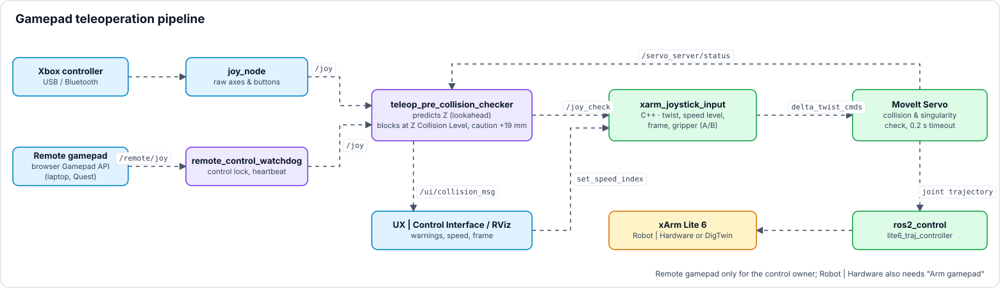

<a name="top"></a>

# 🎮 Operating Modes & Gamepad Teleoperation

[🏠 Overview](../readme-en.html) · [🇩🇪 Deutsch](../de/teleoperation.html) · Chapter 3.1–3.3, 5

**Contents:** [3.1 Operating Modes: Robot | Digital Twin vs. Robot | Hardware (Hardware Interfaces)](#31-operating-modes-fake-vs-real-hardware-interfaces) · [3.2 Feature: Gamepad Teleoperation & Hard Collision Protection](#32-feature-gamepad-teleoperation--hard-collision-protection) · [3.3 Feature: Leap Motion 2 Hand Control](#33-feature-leap-motion-2-hand-control) · [5. 🎮 Gamepad Control — Deep Dive](#5--gamepad-control--deep-dive)

---

## 3.1 Operating Modes: Robot | Digital Twin vs. Robot | Hardware (Hardware Interfaces)
The platform strictly distinguishes between two operating modes for the robot arm. This distinction refers **exclusively to the `ros2_control` hardware interface** and is independent of sensors (like the camera or YOLO, which can run live in both modes):

-blue?style=for-the-badge)<br>
The robot runs via the `mock_components/GenericSystem` (or FakeSystem) hardware interface within `ros2_control`. There is no physical controller connection. Commands to the `/lite6_traj_controller` or `/servo_server` are purely virtually rendered in RViz2 by mirroring the joint states. Proprietary UFactory API calls (like Mode/State switches) intentionally lead nowhere in this mode or are bypassed in software.

-red?style=for-the-badge)<br>
The `ros2_control` framework integrates the real `xarm_api` hardware interface, which communicates directly via TCP/IP with the physical controller of the xArm Lite 6. In this mode, hardware limits, physical safety stops, and the exclusive switching of proprietary xArm hardware modes (e.g., Mode 0 for pose control vs. Mode 1 for Servo/jogging) take effect via the UFactory API.

> [!NOTE]
> **Virtual Linear Axis (Simulation Only):** In Robot | Digital Twin mode, it is possible to mount the robot on a virtual linear axis without affecting the MoveIt planning group (`lite6`).
> - **Activation:** With `attach_to:=linear_axis_link` the Robot | Digital Twin launch (`lite6_moveit_servo_fake.launch.py`) starts the `fake_linear_axis` node by itself. **RUN DEV SETUP (Robot | Digital Twin)** passes this argument; when starting manually, append it to the launch command.
> - **Control:** The GUI slider in the Web UI (Port 8081) or gamepad D-Pad (Left/Right) controls the horizontal translation by publishing `/linear_axis_cmd`. The headless node `fake_linear_axis` (`ros2 run fake_linear_axis fake_linear_axis`) translates this into the dynamic TF and visual rail markers.
> - **MoveIt Architecture:** The axis is shifted purely via dynamic TF (`world` -> `linear_axis_link`), completely decoupled from the URDF joints. This ensures MoveIt automatically recognizes the new base pose for planning/collision detection without needing a 7-DoF IK solver.
> - **URDF Modification:** To prevent parsing errors with dynamic `attach_to` arguments, `xarm_description/urdf/xarm_device_macro.xacro` was modified. The `create_attach_link` condition now generates a root link for *any* custom `attach_to` string, rather than being hardcoded to only `"world"`.

<br>

### 3.1.1 📊 Simulation (Robot | Digital Twin) vs. Real Hardware (Robot | Hardware) Matrix
The table below illustrates which project modules can be evaluated in pure software simulation on a standard PC versus which features require physical hardware devices:

<details>
<summary><b>🔽 Show table</b> · 17 subsystems · Robot | Digital Twin vs. Robot | Hardware · required hardware</summary>

| Feature / Subsystem | Pure Simulation (Robot | Digital Twin) | Real Hardware (Robot | Hardware) | Required Hardware / Peripheral |
|---|:---:|:---:|---|
| **UX \| Control Interface (Port 8081)** | ✅ Functional (RViz Mirror) | ✅ Functional (Hardware Motion) | Host PC & Web Browser |
| **Physics-Sandbox (virtual grasping)** | ✅ Functional | ➖ Simulation Only | Host PC |
| **Remote Control (client / server)** | ✅ Functional | ✅ Functional (stricter limits) | Laptop, tablet or Quest 3 in the home network |
| **UX \| Compact Interface (`/touch`)** | ✅ Functional | ✅ Functional | Extra touch display (USB + HDMI) |
| **UX \| Monitoring (Port 8083)** | ✅ Functional | ✅ Functional | Host PC & Web Browser |
| **MoveIt 2 Cartesian Path Planning & IK** | ✅ Functional | ✅ Functional | Host PC |
| **Virtual Linear Rail Axis** | ✅ Functional | ➖ Simulation Only | Host PC |
| **Gamepad Teleoperation (MoveIt Servo)** | ✅ Functional | ✅ Functional | Xbox One / Series Controller |
| **Predictive Hard Collision Guard** | ✅ Functional | ✅ Functional | Host PC |
| **Acoustic Speech Interaction (Whisper AI)** | ✅ Functional | ✅ Functional | Standard USB / Laptop Microphone |
| **VLA-M chat (Vision-Language-Action)** | 🧪 VLA agent plans and moves the arm (pick & place, also virtual objects with the Physics-Sandbox) | 🧪 Plan only (execution with `allow_real_motion:=true`) | Host PC, NVIDIA GPU for the local language model (Ollama, ~16 GB VRAM) |
| **3D YOLO Object Detection & Clustering** | ❌ *(or via Rosbag replay)* | ✅ Functional | Stereolabs ZED Mini (USB 3.0) |
| **Dynamic MoveIt Collision Objects** | ❌ *(or via Rosbag replay)* | ✅ Functional | Stereolabs ZED Mini (USB 3.0) |
| **Autonomous 3D Grasp Routine** | ❌ *(Needs 3D Camera)* | ✅ Functional | xArm Lite 6 & ZED Mini |
| **Tobii gaze control** | ❌ *(Needs Glasses)* | ✅ Functional | Tobii Pro Glasses 3 (Wi-Fi / LAN) |
| **Meta Quest 3 WebXR Teleoperation** | ❌ *(Needs VR Headset)* | ✅ Functional | Meta Quest 3 (Wi-Fi, Port 8443) |
| **Leap Motion 2 hand control (TCP follows the hand)** | ✅ Functional (also with a recording, `source:=replay`) | ✅ Functional (confirm on switch-on, half speed) | Ultraleap Leap Motion 2 (USB, robot PC) |

</details>

---
<br>


## 3.2 Feature: Gamepad Teleoperation & Hard Collision Protection
*This subsystem manages the manual jogging of the robot via the Xbox controller and actively prevents the robot from colliding with the workspace surface due to operator error.*

---

<br>

###  `xarm_joystick_input.cpp` &nbsp;&nbsp; <sub><i>`/src/xarm_ros2/xarm_moveit_servo/src/xarm_joystick_input.cpp`</i></sub>

**Purpose & Task:** Translates the sanitized gamepad signals (analog sticks & triggers) into Cartesian velocity commands (`TwistStamped`) for MoveIt Servo. Applies exponential smoothing and handles all button mappings.

<details>
<summary><b>🔽 Show details</b> · Run Command · Subscribes · Publishes · TF2 · Services · Action Client</summary>

> [!NOTE]
> 💻 **Run Command:**
> ```bash
> # Real Hardware MoveIt Servo (with vacuum gripper & 3D scene objects):
> ros2 launch xarm_moveit_servo lite6_moveit_servo_realmove.launch.py robot_ip:=192.168.1.xxx add_vacuum_gripper:=true report_type:=dev static_objects:=true
>
> # Simulation / Fake Hardware (with virtual linear axis & 3D scene objects):
> ros2 launch xarm_moveit_servo lite6_moveit_servo_fake.launch.py add_vacuum_gripper:=true attach_to:=linear_axis_link static_objects:=true
> ```
> *`rviz:=false` starts MoveIt Servo without the RViz window (default `true`; in the UX | Nexus Launcher (formerly Nexus Webapp) as the `rviz:=true` checkbox on the servo action card).*
> *Further arguments of both launch files: `joystick_and_checker:=false` starts neither `joy_node` nor `teleop_pre_collision_checker` (used by the server sequences, where the gamepad sits on the client PC); `floor_collision:=false` skips `moveit_floor_collision`. Both launches also include `standalone_move_group.launch.py`.*
> *(Loaded natively as Component inside the MoveIt Servo bringup)*
>
>
> **🎮 Controller Mapping (Quick Reference):**
>> | Input | Action | Details |
>> | :--- | :--- | :--- |
>> | **Left Stick** (↕️/↔️) | **Translate (X / Y)** | *Moves the robot forward/backward (X) and left/right (Y)* |
>> | **LT / RT** (Triggers) | **Translate (Z)** | *Moves the robot arm up (LT) and down (RT)* |
>> | **LB / RB** (Bumpers) | **Rotate (Yaw)** | *Rotates the end effector around its vertical axis* |
>> | **D-Pad** (↕️) | **Speed Control** | *Cycles through 5 speed levels* |
>> | **D-Pad** (↔️) | **Linear Axis** | *Moves the robot along the rail (Base Y-Shift)* |
>> | **START / BACK** | **Reference Frame** | *Toggles between base (`link_base`) and tool coordinates (`link_tcp`)* |
>> | **Button A** (🟢) | **Gripper Open / Close or Vacuum On / Off** | *Depends on the launch argument: `add_gripper:=true` toggles the Lite 6 gripper open/closed, `add_vacuum_gripper:=true` toggles the vacuum on/off. Without either (`gripper_type: none`) the button does nothing.* |
>> | **Button B** (🔴) | **Gripper Off** | *Lite 6 gripper: stops immediately and releases the holding force. Vacuum: switches off.* |
>> | **Button X** (🔵) | **Microphone (Voice)** | *Starts/Stops recording for Whisper AI* |
>> | **Button Y** (🟡) | **Home Pose** | *Moves the robot to the safe home pose* |
>
>
> 
>
>> | Topic / Interface | Msg Type | Description |
>> |---|---|---|
>> | **`/joy_check`** | `sensor_msgs/Joy` | *Reads the sanitized controller inputs from the guardian node.* |
>> | **`/ui/robot_control/set_speed_index`** | `std_msgs/Int32` | *Receives speed setting adjustments from UI or gamepad.* |
>> | **`/ui/gripper_cmd`** | `std_msgs/String` | *Gripper command from the UX \| Control Interface (`open` / `close` / `off` / `toggle`) - runs through the same logic as buttons A/B.* |
>
>
> 
>
>> | Topic / Interface | Msg Type | Description |
>> |---|---|---|
>> | **`/servo_server/delta_twist_cmds`** | `geometry_msgs/TwistStamped` | *Sends Cartesian velocity commands to the Servo Server.* |
>> | **`/ui/eef_position`** | `std_msgs/Float32MultiArray` | *Publishes the live end-effector pose at 10 Hz for the Web UI: `[x, y, z]` in mm plus the orientation quaternion `[qx, qy, qz, qw]` (`link_base` ➔ `link_tcp`).* |
>> | **`/ui/robot_control/current_speed`** | `std_msgs/Float32` | *Publishes the current speed factor for the UI.* |
>> | **`/ui/joy_button_presses`** | `std_msgs/String` | *Publishes human-readable UI button events from gamepad.* |
>> | **`/ui/gripper_state`** | `std_msgs/String` (latched) | *Gripper state (`open` / `closed` / `off`) - keeps the gamepad toggle and the UI buttons in sync.* |
>> | **`/ui/gripper_type`** | `std_msgs/String` (latched) | *Configured gripper (`vacuum` / `gripper` / `none`) from the launch argument.* |
>> | **`/ui/robot_control/current_frame`** | `std_msgs/String` | *Publishes the current reference frame (`link_base` or `link_tcp`).* |
>> | **`/linear_axis_cmd`** | `std_msgs/Float64` | *Publishes the command to move the linear axis.* |
>
>
> 
>
>> | Frame / Transformation | Description |
>> |---|---|
>> | **`link_base` ➔ `link_tcp`** | *Listens to the current TCP position for live telemetry computation.* |
>
>
> 
>
>> | Topic / Interface | Msg Type | Description |
>> |---|---|---|
>> | **`/servo_server/start_servo`** | `std_srvs/srv/Trigger` (Client) | *Starts the MoveIt Servo engine on bringup.* |
>> | **`/servo_server/stop_servo`** | `std_srvs/srv/Trigger` (Client) | *Safely stops the MoveIt Servo engine.* |
>> | **`/ufactory/set_vacuum_gripper`** | `xarm_msgs/srv/VacuumGripperCtrl` (Client) | *Vacuum on/off (Button A, Button B = off) with `add_vacuum_gripper:=true`.* |
>> | **`/ufactory/open_lite6_gripper`** | `xarm_msgs/srv/Call` (Client) | *Opens the Lite 6 gripper (Button A, with `add_gripper:=true`).* |
>> | **`/ufactory/close_lite6_gripper`** | `xarm_msgs/srv/Call` (Client) | *Closes the Lite 6 gripper (Button A, with `add_gripper:=true`).* |
>> | **`/ufactory/stop_lite6_gripper`** | `xarm_msgs/srv/Call` (Client) | *Stops the Lite 6 gripper immediately, releasing the holding force (Button B, with `add_gripper:=true`).* |
>> | **`/ufactory/get_position`** | `xarm_msgs/srv/GetFloat32List` (Client) | *Queries the current Cartesian controller position from the xArm driver.* |
>> | **`/ui/execute_initial_pose`** | `std_srvs/srv/Trigger` (Client) | *Moves the robot to the defined home pose (button Y).* |
>
>
> 
>
>> | Topic / Interface | Msg Type | Description |
>> |---|---|---|
>> | **`/whisper/inference`** | `whisper_idl/action/Inference` | *Starts/cancels Whisper AI speech recognition on button press (Button X).* |

</details>

---

<br>

###  `teleop_pre_collision_checker.py` (`teleop_pre_collision_checker`) &nbsp;&nbsp; <sub><i>`/src/teleop_pre_collision_checker/teleop_pre_collision_checker/teleop_pre_collision_checker.py`</i></sub>

**Purpose & Task:** Acts as a transparent guardian *before* movement execution. Limits the downward speed so that the travel within 0.25 s does not reach below the table barrier (`Z_LIMIT` = Z Collision Level, default 10 mm); faster downward commands are throttled (right trigger reduced). At z ≤ `Z_LIMIT` or when less than 10 mm/s would be allowed (z < `Z_LIMIT` + 2.5 mm), it blocks downward motion entirely, reports it on `/ui/collision_msg` and triggers gamepad rumble feedback (vibration via `pygame`).

<details>
<summary><b>🔽 Show details</b> · Run Command · Subscribes · Publishes · Parameters</summary>

> [!NOTE]
> 💻 **Run Command:**
> ```bash
> ros2 run teleop_pre_collision_checker teleop_pre_collision_checker
> ```
>
>
> 
>
>> | Topic / Interface | Msg Type | Description |
>> |---|---|---|
>> | **`/joy`** | `sensor_msgs/Joy` | *Raw gamepad inputs from `joy_node`.* |
>> | **`/servo_server/status`** | `std_msgs/Int8` | *MoveIt Servo warning codes (approaching/halt collision/singularity).* |
>> | **`/ui/eef_position`** | `std_msgs/Float32MultiArray` | *Live end-effector pose for real-time Z-height checking.* |
>> | **`/ui/robot_control/current_speed`** | `std_msgs/Float32` | *Current velocity scaling factor for accurate lookahead prediction.* |
>> | **`/ui/moveit_collision_ground_enabled`** | `std_msgs/Bool` (latched) | *Follows the ground collision switch of the UX \| Control Interface: when it is OFF, downward motion is no longer blocked. Without a message (node not running) the block stays active.* |
>> | **`/ui/ground_collision_level`** | `std_msgs/Float64` (latched) | *Z Collision Level in mm (TCP height) from `moveit_floor_collision`, set in the ground collision popup of the UX \| Control Interface → `Z_LIMIT`, caution zone starts 19 mm above. Clamped to 0–200 mm. Until the first message a strict fallback of 91 mm applies (without that node MoveIt Servo has no floor box either).* |
>> | **`/ui/emergency_stop_active`** | `std_msgs/Bool` (latched) | *E-STOP latched → gamepad blocked; after the reset `/joy` passes only after 0.3 s in neutral (`NEUTRAL_HOLD`).* |
>> | **`/ui/emergency_stop_topic`** | `std_msgs/Empty` | *E-STOP pressed → blocks at once, even if the motion handler hangs; released only after the reset (true → false).* |
>
>
> 
>
>> | Topic / Interface | Msg Type | Description |
>> |---|---|---|
>> | **`/joy_check`** | `sensor_msgs/Joy` | *Sanitized gamepad signal forwarded to `xarm_joystick_input`.* |
>> | **`/ui/collision_msg`** | `std_msgs/String` | *Publishes collision warnings to RViz overlay and Web UI.* |
>> | **`/ui/emergency_stop_topic`** | `std_msgs/Empty` | *Only if `/ui/emergency_stop_active` reports `false` without a preceding `true` after an E-STOP (motion handler restarted while hanging): sends the E-STOP again (up to 5×, 1 Hz, `ESTOP_RESEND_TRIES`) until the new motion handler latches.* |
>
> *The haptic rumble feedback of the Xbox controller is not sent over ROS but triggered directly on the joystick device via `pygame` (`joystick.rumble(...)`).*
>
> *Browser-side feedback in the UX | Control Interface (formerly Robot Control UI) (port 8081), only while this client holds the control lock (`hasControlLock()` in `js/remote.js`):*
> - *`js/gamepad.js`: gamepad connected to the browser rumbles (Gamepad API `vibrationActuator.playEffect('dual-rumble')`) while the robot moves within 20 mm of the Z Collision Level, within 20 mm of the unreachable zone around the axis, within 30 mm of the 440 mm reach (measured from the shoulder, Z 243.5 mm), in the outer 10 % of a joint range or on a Servo singularity / joint-limit / collision status; strength grows towards the limit.*
> - *`js/twin/xr_feedback.js`: Quest 3 controllers pulse on grasp contact (vacuum `closed` or object held in the Physics-Sandbox) and repeatedly near the same limits.*
> - *`js/sound.js`: synthesized tones (Web Audio API, no audio files) for vacuum ON/OFF, limit warning and E-STOP; muted together with the sound switch in the header.*
>
>
> 
>
>> | Parameter | Value | Description |
>> |---|---|---|
>> | `LOOKAHEAD_TIME` | `0.25` | *Prediction horizon (seconds) for velocity lookahead.* |
>> | `Z_LIMIT` | `91.0` → Level | *Hard table barrier on the Z-axis (`link_base`) in millimeters; follows `/ui/ground_collision_level`.* |
>> | `CAUTION_ZONE_START` | `Z_LIMIT + 19` | *Z-height (mm) where downward velocity starts being restricted (`CAUTION_ZONE_MARGIN` 19 mm above `Z_LIMIT`).* |
>> | `CAUTION_ZONE_SPEED` | `0.25` | *Maximum allowed downward speed factor within the caution zone.* |
>> | `MAX_LINEAR_VELOCITY_MM_S` | `400.0` | *Baseline linear velocity (mm/s) for the lookahead.* |
>> | `MIN_DOWN_SPEED_MM_S` | `10.0` | *Minimum downward speed (mm/s); if the look-ahead allows less, downward motion is blocked entirely (collision message).* |
>> | `ACCELERATION_FACTOR` | `0.9` | *Damping factor applied during lookahead calculation.* |
>> | `DOWN_TRIGGER_AXIS` | `5` | *Joy axis index of the right trigger (RT, downward).* |
>> | `UP_TRIGGER_AXIS` | `2` | *Joy axis index of the left trigger (LT, upward); Z speed = LT − RT, so the guard limits the net downward share.* |
>> | `EEF_TIMEOUT` | `1.0` | *Seconds without a new `/ui/eef_position` after which the position counts as unknown and downward motion is blocked.* |

</details>

---

<br>

###  `laser_pointer_node.py` (`tcp_laser_pointer`) &nbsp;&nbsp; <sub><i>`/src/tcp_laser_pointer/tcp_laser_pointer/laser_pointer_node.py`</i></sub>

**Purpose & Task:** Continuously monitors the real Cartesian Z-height of the Tool Center Point (`link_tcp`) relative to the robot base (`link_base`) via TF2 at 10 Hz. Whenever the TCP reaches a height of $50\text{ mm}$ ($0.05\text{ m}$) or below, it automatically turns ON the hardware laser pointer mounted on the gripper via the digital tool output (TGPIO Digital Out 0). Once the height exceeds this threshold, the node immediately switches the laser pointer OFF.

<details>
<summary><b>🔽 Show details</b> · Run Command · TF2 · Services</summary>

> [!NOTE]
> 💻 **Run Command:**
> ```bash
> ros2 run tcp_laser_pointer laser_pointer_node
> ```
>
>
> 
>
>> | Frame / Transformation | Description |
>> |---|---|
>> | **`link_base` ➔ `link_tcp`** | *Monitors the live Cartesian TCP position at 10 Hz.* |
>
>
> 
>
>> | Topic / Interface | Msg Type | Description |
>> |---|---|---|
>> | **`/ufactory/set_tgpio_digital`** | `xarm_msgs/srv/SetDigitalIO` (Client) | *Controls Tool Digital Output 0 (TGPIO) on the gripper to switch the laser pointer ON (1) or OFF (0); namespace from parameter `hw_ns` (default `ufactory`).* |

</details>

---

<br>

###  `_robot_moveit_servo_fake.launch.py` / `_robot_moveit_servo_realmove.launch.py` (`xarm_moveit_servo`) &nbsp;&nbsp; <sub><i>`/src/xarm_ros2/xarm_moveit_servo/launch`</i></sub>

**Purpose & Task:** The real-time motion engine from MoveIt. Checks every command against the planning scene (YOLO collision objects, floor) and slows down / halts the arm before it collides with objects.

<details>
<summary><b>🔽 Show details</b> · Subscribes · Publishes · Parameters</summary>

> [!NOTE]
> 
>
>> | Topic / Interface | Msg Type | Description |
>> |---|---|---|
>> | **`/servo_server/delta_twist_cmds`** | `geometry_msgs/TwistStamped` | *Reads incoming Cartesian velocity commands.* |
>> | **`/planning_scene`** | `moveit_msgs/PlanningScene` | *Reads the current 3D scene for obstacle avoidance.* |
>
>
> 
>
>> | Topic / Interface | Msg Type | Description |
>> |---|---|---|
>> | **`/lite6_traj_controller/joint_trajectory`** | `trajectory_msgs/JointTrajectory` | *Sends safe, collision-free joint trajectories to the arm.* |
>
>
>  **(`xarm_moveit_servo_config.yaml`)**
>
>> | Parameter | Default | Description |
>> |---|---|---|
>> | `check_collisions` / `collision_check_rate` | `true` / `10.0` | *Collision checking of the whole robot body at 10 Hz.* |
>> | `self_collision_proximity_threshold` / `scene_collision_proximity_threshold` | `0.01` | *Below these distances (1 cm) Servo slows down exponentially in all directions.* |
>> | `collision_check_type` | `stop_distance` | *Setting of the stop-distance mode (slow down from ~5 cm, halt at 2 cm via `min_allowable_collision_distance: 0.02`). According to the comment in the config, MoveIt Servo in Humble only evaluates the threshold mode, so the proximity thresholds above decide in practice.* |
>> | `collision_distance_safety_factor` | `0.5` | *Safety factor of the stop-distance mode.* |

</details>

---
<br>


## 3.3 Feature: Leap Motion 2 Hand Control
*A Leap Motion 2 at the robot PC tracks one hand from below: pinching thumb and index finger couples the hand to the TCP, the TCP follows the hand, opening the hand stops it. Operated from the viewport of the UX | Control Interface; translation only, no rotation.*

---

<br>

###  `leap_hand_teleop_node.py` (`leap_hand_teleop`) &nbsp;&nbsp; <sub><i>`/src/leap_hand_teleop/leap_hand_teleop/leap_hand_teleop_node.py`</i></sub>

**Purpose & Task:** Turns the pinched hand into Cartesian velocity: TCP target = TCP position at the moment of coupling + hand path / scale (1:1, 1:2, 1:4), followed by a P controller (dead band 1.5 mm, at most 300 mm per axis and grab). No motion path of its own: like the VR node it sends `/remote/twist` to the twist gate of `remote_control_watchdog` (control lock, heartbeat, E-STOP, floor guard) → MoveIt Servo. The hand data comes from `leap.py` of `~/__project_claude_ops` (own repo next to dev_ws) (loaded by path). Source of truth: package README; setting up the Ultraleap software: `~/__project_claude_ops/README.md`, section *Gestensteuerung (Leap Motion 2 oder Webcam)* › *Leap Motion 2 einrichten*.

```text
Leap Motion 2 ──▶ leap_hand_teleop_node ──▶ /remote/twist ──▶ remote_control_watchdog ──▶ /servo_server/delta_twist_cmds ──▶ MoveIt Servo
```

**Operation (UX | Control Interface, viewport):**

| Step | Action | Result |
|---|---|---|
| Switch on | ✋ **Gestures** in the viewport toolbar | With a Leap Motion 2 connected and the node running, Gestures picks the Leap instead of the webcam; the window **LEAP** opens bottom right in the viewport. Robot \| Hardware (also mode unknown): dialog *Switch on Leap hand control for the real robot?* – hold **Hold to switch on** for 1 s |
| Show the hand | One hand about 20 cm above the Leap Motion, open | Chip **Ready**; the ring shows the hand from above, the arc = pinch strength |
| Couple | Pinch thumb and index finger, other fingers relaxed | Chip **Coupled**; the TCP follows the hand – centre of the ring = TCP, dot = TCP target |
| Stop | Open the hand | Zero twist, decoupled; to go on: pinch again |
| Scale | Button **1:2** in the LEAP window | Cycles 1:1 / 1:2 / 1:4 (1:2 = TCP moves half the hand path), applies immediately, kept per browser |
| Switch off | **Gestures** again | Window closes; switching Robot \| Digital Twin ↔ Robot \| Hardware or 2 s without data from the Leap node also switches it off. Hiding the tab: in Robot \| Hardware (also mode unknown) switches it off – switching on again asks with the 1 s hold dialog; in Robot \| Digital Twin it only pauses (the node stops and decouples), back on the tab couple with a new pinch |

- **Speed:** speed override in the header (5 levels = factor 0.1–0.5 on `/ui/robot_control/current_speed`, × 400 mm/s → 40 / 80 / 100 / 100 / 100 mm/s), 40 mm/s without a level, never above `max_speed_mm_s` (100 mm/s). Outside Robot | Digital Twin (also mode unknown) additionally × `real_max_speed` of the watchdog (default 0.5) – half speed, as for remote clients.
- **Ghost hand:** Layers panel › **Leap hand** (*Ghost at the TCP*) shows the tracked hand at the TCP in the Digital Twin – display only, only while Leap hand control is on.
- **Only one hand:** pinching is no enabling switch – any pinching hand above the Leap moves the robot. A second hand above the Leap always stops (chip **No hand**). In Robot | Hardware only your own hand above the Leap.

#### Free gestures (mode **Free** in the LEAP window)
*The second mode next to „TCP follows the hand“: the hand is only a pointer in the 3D viewport – the robot never follows it.* Switch with the two buttons **TCP | Free** at the top of the LEAP window (kept per browser). In Free the node gets „off“ all the time (`/leap/config` `on:false`), so nothing couples; clicks work only on the grasp points of the virtual objects and on the buttons of the object menu.

| What | How | Result |
|---|---|---|
| Point | Index fingertip above the Leap Motion | A dot follows the fingertip in the viewport; a grasp point under it glows like with the mouse |
| Click | Hold the fingertip still **2 s** (default, *Click after*) on a grasp point or a menu button (ring closes) | Object menu opens / the button is clicked; the next click needs a move away first |
| Zoom | Pinch thumb and index finger with **both hands**, spread = zoom in, together = zoom out | Smooth dolly of the camera, same limits as the mouse wheel |

Robot \| Hardware: switching on asks with the 1 s hold dialog (*Switch on free gestures for the real robot?*), switching from Free back to TCP asks again. The hand clicks only info / edit / setting buttons of the object menu and never faster than 2 s – everything else (**Approach from above**, **Grasp** …) stays with the mouse. Clicks and zoom pause (the dot stays) while the node does not confirm „off“ – e.g. another browser has the TCP coupled or Leap control on, and during calibration. Hand poses linked to commands (Remote › Gestures) rest in Free and during calibration – except *Stop planned motion*, which stays available.

**Calibration per user** (Remote › Gestures › *Free gestures: calibrate for your hand*): 8 short steps with a live top view of the hand (the frame is the 3D view) – far left / right / near / far fingertip, open hand, pinch, both hands together, both hands apart. Every step is taken over when the hand rests for ~1.2 s. The result sets the reach of the pointer, the pinch thresholds and the zoom strength; the pointer in the viewport uses the new values at once. *Save profile* stores it under a name in the browser (up to 12 profiles, **Export / Import** as JSON, built-in values = default), *Click after* sets the hold time (0.8–5 s; in Robot \| Hardware at least 2 s). During the calibration clicks and zoom are paused and the node stays „off“. Needs the restarted node `leap_hand_teleop` (publishes `hands`) – otherwise the LEAP window says so. Test: `python3 tools/test_gesture_free.py`.

**Gesture commands** (window **Remote Teleop** › **Gestures**, source = Leap Motion or webcam): your own poses trigger commands. Pinch (couple) and open hand (release) stay fixed in the Leap node and cannot be assigned.

| Step | Action | Result |
|---|---|---|
| Calibrate | Select a gesture (Fist, Thumbs up, Point up, Thumbs down), **Record – hold 2 s**, keep the pose still | Template per source (Leap / webcam) saved in the browser; live match in %, finger bars with a tick for your recording. Poses that look too similar, or that the Leap reads as a pinch, are flagged |
| Link | Pick a command and a hold time (0.3–5 s, minimum per command) per gesture | Close / open gripper (also Robot \| Hardware, hold ≥ 1 s), next hand scale 1:n (Leap only), speed ±1, stop planned motion (always allowed). Defaults: Fist = close gripper, Thumbs up = open gripper, Point up = next hand scale, Thumbs down = stop (0.5 s); a calibrated gesture is armed at once, **No command** disarms it |
| Run | Gestures switched on, hand not coupled, hold the pose for the hold time | Fires once per show, then a 2 s pause; the command takes the same way as its button (control lock, E-STOP, rosbridge connection; no extra confirmation – the hold time replaces it). Chip **Locked** (e.g. planned motion running) does not block commands – that is what *Stop planned motion* is for. Not calibrated poses and a coupled hand never fire |
| Backup | **Export** / **Import** | JSON file `rcu_gestures.json` with calibrations and commands (checked on import) |

- **Fist and pinch:** the Leap reads some poses (often the fist) as a pinch (≥ 85 %). The node never couples a fist (middle, ring and little finger curled or Leap grab strength ≥ 50 %), but other poses read as a pinch would couple the TCP to the hand and the command would not fire – such a gesture is shown as *Read as pinch – not armed* and the page warns. Recording with the Leap needs Gestures switched off (the node then cannot couple); while coupled the recording is rejected. Choose another pose.
- **Open gripper:** in Robot | Hardware (also mode unknown), while the gripper may hold an object (state not open/off), the gesture needs a second show within 5 s – as with voice control.
- **Webcam in Robot | Hardware:** switching Gestures on asks with the 1 s hold dialog like the Leap; switching between Robot | Digital Twin and Robot | Hardware switches it off.

**Dead man and locks** (every event = zero twist and decoupled; coupling again needs a visibly open hand after the event, then a new pinch started within 2 s of the last open hand (held for 0.15 s) – a pinch held through the event never starts by itself, an open hand shown during a lock does not count; a new hand also opens first. **Fist:** middle, ring and little finger curled or a Leap grab strength ≥ 0.5 (catches the loosely closed fist) never count as a pinch, even if the Leap reports one – while coupled a fist stops like an open hand):

| Event | Shown as (chip **Locked** or **No hand**) |
|---|---|
| Hand opened or fist, hand gone or invalid hand values (NaN, outside 0–1), no data for 100 ms (`data_timeout_s`) | *Hand opened – pinch again to couple* (only for a moment, then chip **Ready**) · *Fist detected – a fist does not couple. Open the hand, then pinch thumb and index finger with the other fingers relaxed* · *No hand above the Leap Motion* (also for invalid values) · *No data from the Leap Motion* |
| Second hand above the Leap (even while the coupled hand stays visible); coupling again only once a single hand is left | *Two hands above the Leap Motion – keep only one hand there* |
| Poor tracking (`min_confidence`), jump > `jump_mm`, a different hand | *Hand not tracked reliably – hold it flat and steady* · *A different hand was detected* (only for a moment). A short dropout (confidence below `min_confidence` or missing frames, in total < 0.3 s) only **holds** the TCP – the chip stays *Coupled* and shows the reason; weak frames never steer the target, after 0.2 s of good tracking the hand continues without a new pinch. Hand gone, open hand, fist, jump or a second hand still decouple at once |
| UI switched Leap off, tab hidden, no `/leap/config` for 0.75 s (before the watchdog's 1 s heartbeat stop) | *Leap control is off* |
| Browser without control, `/leap/config` from another browser with control while coupled | *This browser has no control (control lock)* · *Another browser switched Leap control on – stopped here* |
| E-STOP, planned motion running (`/ui/motion_busy`), mobile base moving (`/mobile_base/moving`) | *Emergency stop is latched* · *A planned motion is running* · *The mobile base is moving* |
| TCP pose (tf) missing or older than 0.15 s | *No robot pose (tf) – is the robot stack running?* |
| Recording (`source:=replay`) outside Robot \| Digital Twin | *Recorded hand data (replay) only moves the robot in Robot \| Digital Twin* |

Events without a lasting lock (hand opened, a different hand, another browser) show their text only for a moment; then the chip shows **Ready** – with the hand still pinched together with *Open the hand, then pinch again*. *Invalid values from the Leap Motion – stopped* only appears if the computed velocity is not finite (e.g. NaN from tf).

<details>
<summary><b>🔽 Show details</b> · Run Command · Subscribes · Publishes · Parameters</summary>

> [!NOTE]
> 💻 **Run Command:**
> ```bash
> # with the UX | Control Interface (robot PC only, never on clients):
> ros2 launch http_robot_control_ui_p8081 http_robot_control_ui.launch.py leap_hand:=true
>
> # alone, test without the device using a recording (moves only in Robot | Digital Twin):
> ros2 launch leap_hand_teleop leap_hand_teleop.launch.py source:=replay
> ```
>
>
> 
>
>> | Topic / Interface | Msg Type | Description |
>> |---|---|---|
>> | **`/leap/config`** | `std_msgs/String` (JSON) | *`{"id", "on", "scale"}` from the UI every 250 ms; only on the local rosbridge 9092 (robot PC), blocked for remote clients in `config/network.yaml`.* |
>> | **`/ui/robot_control/current_speed`** | `std_msgs/Float32` (latched) | *Speed level 0–1 of the UI (share of 400 mm/s).* |
>> | **`/remote/control_state`** | `std_msgs/String` (JSON) | *Owner of the control lock, mode `fake`/`real`, `limits.real_max_speed`.* |
>> | **`/ui/emergency_stop_active`**, **`/ui/motion_busy`**, **`/mobile_base/moving`** | `std_msgs/Bool` (latched) | *Blocks coupling while true.* |
>> | **`/ui/emergency_stop_topic`** | `std_msgs/Empty` | *E-STOP pressed: latches at once; released only after `/ui/emergency_stop_active` true → false.* |
>> | **tf** base → TCP | `tf2` | *Current TCP position; older than 0.15 s = stop.* |
>
>
> 
>
>> | Topic / Interface | Msg Type | Description |
>> |---|---|---|
>> | **`/remote/twist`** | `std_msgs/String` (JSON) | *Cartesian velocity with the client id at 50 Hz, only while coupled – same twist gate as jogging and the VR node.* |
>> | **`/leap/hand`** | `std_msgs/String` (JSON) | *State for the ring at 30 Hz: `state` (`nohand`/`ready`/`blocked`/`coupled`) + `reason`, `scale`, `tcp`, `target`, `delta` (mm), `hand` (21 joints, relative to the pinch point), `hands` (up to 2 hands, absolute from the sensor origin, only for the pointer and zoom of the free gesture mode – moves nothing).* |
>
>
> 
>
>> | Parameter | Default | Description |
>> |---|---|---|
>> | `source` | `leap` | *`leap` = device, `replay` = recording `replay_file` (plays once; endlessly with node parameter `replay_loop` true – not a launch argument); Gestures never picks a recording.* |
>> | `mount_yaw_deg` | `0.0` | *Viewing direction of the user: 0 = behind the robot looking along +X, 180 = opposite.* |
>> | `max_speed_mm_s` | `100.0` | *Upper speed limit (5–250).* |
>> | `kp` / `deadband_mm` / `smooth` | `4.0` / `1.5` / `0.35` | *P controller, dead band, smoothing; `kp` ≤ 8.* |
>> | `max_offset_mm` / `jump_mm` | `300.0` / `60.0` | *Max. offset per axis and grab; hand jump that decouples (≤ 100).* |
>> | `min_confidence` / `data_timeout_s` | `0.5` / `0.1` | *Tracking quality ≥ 0.3; data timeout ≤ 0.2 s. Values outside the limits stop the node at start.* |
>> | `record_file` | *(empty)* | *Writes hand frames as JSONL (new test data).* |

</details>

---
<br>


## 5. 🎮 Gamepad Control — Deep Dive

This section provides a full technical reference for the two-node gamepad pipeline that enables real-time, collision-safe teleoperation of the xArm Lite 6 using an Xbox One Elite Series 2 Controller.

---
<br>


### 5.1 Pipeline Architecture

The gamepad signal is processed in two sequential stages before reaching the MoveIt Servo server. This two-node design cleanly separates **safety enforcement** (Python) from **motion translation** (C++):

<p align="center"></p>

*Gamepad teleoperation pipeline · source: `tools/make_diagrams.py`*

---
<br>


### 5.2 `teleop_pre_collision_checker.py` — Collision Guard (Python Node)

**File:** `src/teleop_pre_collision_checker/teleop_pre_collision_checker/teleop_pre_collision_checker.py`

This node acts as a transparent **safety proxy** between the raw joystick driver and the motion controller. It is **100% hardware-agnostic** (works identically in Robot | Hardware and Robot | Digital Twin modes). It continuously subscribes to the live Z height from `/ui/eef_position` and predictively checks with every incoming `/joy` message whether the robot approaches the table. If a limit is breached, the signal is blocked. It also actively provides **haptic feedback** (gamepad vibration) whenever the robot approaches the table or encounters a dynamic YOLO bounding box obstacle via MoveIt Servo.


#### 5.2.1 Predictive Collision Algorithm

The node does not simply check the current Z position — it **limits the downward speed** so that the travel within the next `LOOKAHEAD_TIME` seconds does not reach below `Z_LIMIT`. Only at z ≤ `Z_LIMIT` or when less than `MIN_DOWN_SPEED_MM_S` would be allowed does it block downward motion entirely:

```
trigger_intensity = clamp(axes[LT] - axes[RT], 0, 1) # as in xarm_joystick_input: half press = full speed
if ground_enabled and current_z < CAUTION_ZONE_START: # caution zone: really slower
 trigger_intensity = min(trigger_intensity, CAUTION_ZONE_SPEED / speed_factor)
 axes[RT] = axes[LT] - trigger_intensity # reduced trigger is forwarded
if ground_enabled and moving_down:
 allowed = (current_z − Z_LIMIT) / LOOKAHEAD_TIME # mm/s that do not reach below Z_LIMIT within Δt
 effective_velocity = V_max × speed_factor × trigger_intensity × α # α = ACCELERATION_FACTOR = 0.9
 if current_z <= Z_LIMIT or allowed < MIN_DOWN_SPEED_MM_S:
  axes[RT] = 1.0 # downward blocked + /ui/collision_msg + rumble
 elif effective_velocity > allowed:
  axes[RT] = axes[LT] − allowed / (V_max × speed_factor × α) # trigger reduced
```

<details>
<summary><b>🔽 Show table</b> · 10 parameters · Z limit · caution zone · lookahead</summary>

| Parameter | Value | Description |
|---|---|---|
| `Z_LIMIT` | Z Collision Level (default `10.0 mm`) | *Absolute Z-limit — downward motion is blocked at this height* |
| `CAUTION_ZONE_START` | `Z_LIMIT + 19 mm` | *Caution zone entry — the right trigger is reduced so that speed level × down share ≤ `CAUTION_ZONE_SPEED`* |
| `CAUTION_ZONE_SPEED` | `0.25` | *Max downward speed factor inside the caution zone* |
| `MAX_LINEAR_VELOCITY_MM_S` | `400.0 mm/s` | *Assumed max linear velocity for prediction* |
| `LOOKAHEAD_TIME` | `0.25 s` | *Prediction horizon* |
| `MIN_DOWN_SPEED_MM_S` | `10.0 mm/s` | *Slower allowed → downward motion blocked entirely (collision message)* |
| `ACCELERATION_FACTOR` (α) | `0.9` | *Velocity damping factor applied to prediction* |
| `DOWN_TRIGGER_AXIS` | `5` (RT) | *Joy axis index for the downward trigger* |
| `UP_TRIGGER_AXIS` | `2` (LT) | *Joy axis index for the upward trigger (net Z = LT − RT)* |
| `EEF_TIMEOUT` | `1.0 s` | *Without a new `/ui/eef_position` the position counts as unknown afterwards — downward motion blocked* |

</details>


---
<br>


#### 5.2.2 Two-Tier Safety Model

```
Z > Z_LIMIT + 19 mm → Full speed, no restrictions
Z_LIMIT + 19 mm ≥ Z > Z_LIMIT → ⚠️ CAUTION ZONE: speed clamped to 25%
Z ≤ Z_LIMIT → 🛑 HARD STOP: downward axis zeroed, rumble triggered
```


### 5.3 `xarm_joystick_input.cpp` — Motion Controller (C++ Node)

**File:** `src/xarm_ros2/xarm_moveit_servo/src/xarm_joystick_input.cpp` 
**Class:** `xarm_moveit_servo::JoyToServoPub` 
**Registered as:** ROS 2 Component (`RCLCPP_COMPONENTS_REGISTER_NODE`)

This node receives the already-sanitized `/joy_check` signal and translates it into `geometry_msgs/TwistStamped` messages for the MoveIt Servo server — enabling smooth, real-time Cartesian velocity control.


#### 5.3.1 Full Controller Button Mapping

<details>
<summary><b>🔽 Show table</b> · 16 inputs · sticks · triggers · bumpers · D-Pad · buttons · speed levels</summary>

| Input | Function | ROS Action | Technical Detail |
|-------|----------|-----------|-----------------|
| **Left Stick ↑↓** | Move X-axis (forward/back) | `TwistStamped.linear.x` | *`axes[1] × speed_scale`* |
| **Left Stick ←→** | Move Y-axis (left/right) | `TwistStamped.linear.y` | *`axes[0] × speed_scale`* |
| **LT (Left Trigger)** | Move Z **up** (Z+) | `TwistStamped.linear.z` | *`clamp(LT−RT, -1,1) × −speed_scale` → LT pressed: negative z value × −scale = **positive Z*** |
| **RT (Right Trigger)** | Move Z **down** (Z−) | `TwistStamped.linear.z` | *`clamp(LT−RT, -1,1) × −speed_scale` → RT pressed: positive z value × −scale = **negative Z*** |
| **LB (Left Bumper)** | Rotate wrist CCW (Z-) | `TwistStamped.angular.z` | *`buttons[LB] - buttons[RB]`* |
| **RB (Right Bumper)** | Rotate wrist CW (Z+) | `TwistStamped.angular.z` | *`buttons[LB] - buttons[RB]`* |
| **D-Pad ↑** | Speed level UP | Publishes to `/ui/robot_control/current_speed` | *Cycles through 5 speed levels* |
| **D-Pad ↓** | Speed level DOWN | Publishes to `/ui/robot_control/current_speed` | *Cycles through 5 speed levels* |
| **D-Pad ←** | Linear Axis Left | Publishes to `/linear_axis_cmd` | *Moves the robot along the rail* |
| **D-Pad →** | Linear Axis Right | Publishes to `/linear_axis_cmd` | *Moves the robot along the rail* |
| **Back (⊞)** | Reference frame → `link_base` | Publishes to `/ui/joy_button_presses` + `/ui/robot_control/current_frame` | *World coordinate mode* |
| **Start (≡)** | Reference frame → `link_tcp` | Publishes to `/ui/joy_button_presses` + `/ui/robot_control/current_frame` | *End-effector relative mode* |
| **A (green)** | Gripper toggle / vacuum on-off | Service: `open/close_lite6_gripper` or `set_vacuum_gripper` | *Depends on `gripper_type` (from `add_gripper` / `add_vacuum_gripper`)* |
| **B (red)** | Gripper off | Service: `/ufactory/stop_lite6_gripper` or `set_vacuum_gripper(on=false)` | *Release holding force / vacuum off* |
| **X (blue)** | Whisper AI voice record | Action: `/whisper/inference` (max 5 sec) | *Toggle: press once to start, again to stop* |
| **Y (yellow)** | Move to home pose | Service: `/ui/execute_initial_pose` | *Calls the `robot_motion_handler_movegroup`* |

**Speed Levels (D-Pad):**

| Level | Factor (`speed_levels_`) | UI display | Description |
|-------|--------|--------|-------------|
| 1 | `0.1` | 20 % | *Ultra-precise — fine positioning* |
| 2 | `0.2` | 40 % | *Slow — near-target approach* |
| 3 | `0.3` | 60 % | *Normal — default start level* |
| 4 | `0.4` | 80 % | *Fast — long-range traversal* |
| 5 | `0.5` | 100 % | *Maximum* |

</details>


#### 5.3.2 Signal Flow & Exponential Smoothing

All continuous axes are passed through an **exponential low-pass filter** to prevent jerky, discontinuous movements from stick input noise:

```
// Applied every callback cycle:
smoothed_value += (target_value - smoothed_value) × smoothing_factor

// Example for X-axis:
smoothed_twist_.linear.x += (target_twist.linear.x - smoothed_twist_.linear.x) × 0.5
```

The full signal chain from hardware to servo:

```
Hardware Input
 └─ /joy (raw axes & buttons)
 └─ teleop_pre_collision_checker.py (safety filter, async position check)
 └─ /joy_check (sanitized signal)
 └─ xarm_joystick_input.cpp
 ├─ Deadzone filter: |val| < 0.1 → 0.0
 ├─ Speed scale: val × speed_levels_[index]
 ├─ Exponential smooth: smoothed += (target - smoothed) × 0.5
 └─ /servo_server/delta_twist_cmds (TwistStamped)
```


#### 5.3.3 Whisper AI Integration (X Button)

The X button integrates **OpenAI Whisper** via a ROS 2 **Action Client** (`rclcpp_action`) — not a simple service. This enables non-blocking, cancellable, real-time speech recording:

```
Press X → async_send_goal (max_duration = 5s)
 ├─ Goal accepted → is_whisper_listening_ = true
 │ → wall_timer starts (5s auto-timeout)
 │ → UI: "✅ EIN - lauscht (5sek)"
 ├─ Press X again → async_cancel_goal()
 │ → UI: "❌ AUS"
 └─ Timeout fires → async_cancel_goal() automatically
 → UI: "❌ AUS (Timeout)"
```

Status feedback is published to `/ui/joy_button_presses` after every state transition, allowing the dashboard to display real-time microphone status.


#### 5.3.4 Topics & Services Reference

<details>
<summary><b>🔽 Show table</b> · 20 entries · Subscribers · Publishers · Service Clients · Action Client</summary>

| Type | Name | Message Type | Description |
|------|------|-------------|-------------|
| **Subscriber** | `/joy_check` | `sensor_msgs/Joy` | *Sanitized joy signal from `teleop_pre_collision_checker.py`* |
| **Subscriber** | `/ui/robot_control/set_speed_index` | `std_msgs/Int32` | *Speed level from the UX \| Control Interface / RViz panel* |
| **Publisher** | `/ui/eef_position` | `std_msgs/Float32MultiArray` | *10 Hz live pose (x, y, z in mm + quaternion qx, qy, qz, qw) for telemetry* |
| **Publisher** | `/servo_server/delta_twist_cmds` | `geometry_msgs/TwistStamped` | *Cartesian velocity command to MoveIt Servo* |
| **Publisher** | `/servo_server/delta_joint_cmds` | `control_msgs/JointJog` | *Joint-space command (initialization only)* |
| **Publisher** | `/ui/robot_control/current_speed` | `std_msgs/Float32` | *Current speed factor (latched QoS)* |
| **Publisher** | `/ui/robot_control/current_frame` | `std_msgs/String` | *Active reference frame (`link_base` or `link_tcp`)* |
| **Publisher** | `/linear_axis_cmd` | `std_msgs/Float64` | *Linear axis position (D-Pad ←/→)* |
| **Publisher** | `/ui/joy_button_presses` | `std_msgs/String` | *Human-readable button feedback for dashboard* |
| **Service Client** | `/servo_server/start_servo` | `std_srvs/srv/Trigger` | *Activates MoveIt Servo on startup* |
| **Service Client** | `/servo_server/stop_servo` | `std_srvs/srv/Trigger` | *Stops MoveIt Servo* |
| **Service Client** | `/ufactory/get_position` | `xarm_msgs/srv/GetFloat32List` | *Current Cartesian position from the xArm driver* |
| **Service Client** | `/ufactory/open_lite6_gripper` | `xarm_msgs/srv/Call` | *Opens the Lite 6 gripper* |
| **Service Client** | `/ufactory/close_lite6_gripper` | `xarm_msgs/srv/Call` | *Closes the Lite 6 gripper* |
| **Service Client** | `/ufactory/stop_lite6_gripper` | `xarm_msgs/srv/Call` | *Stops the Lite 6 gripper and releases the holding force* |
| **Service Client** | `/ufactory/set_vacuum_gripper` | `xarm_msgs/srv/VacuumGripperCtrl` | *Vacuum on/off* |
| **Subscriber** | `/ui/gripper_cmd` | `std_msgs/String` | *Gripper commands from the UX \| Control Interface* |
| **Publisher** | `/ui/gripper_state` / `/ui/gripper_type` | `std_msgs/String` (latched) | *Gripper state and type for the UI* |
| **Service Client** | `/ui/execute_initial_pose` | `std_srvs/srv/Trigger` | *Moves the robot to the home pose via the motion handler* |
| **Action Client** | `/whisper/inference` | `whisper_idl/action/Inference` | *Starts/cancels Whisper voice recording* |

</details>

---

[⬅ Previous: Running the System](running.html) · [🏠 Overview](../readme-en.html) · [⬆ Top](#top) · [Next: 3D Vision & Autonomous Grasping ➡](vision_grasping.html)
